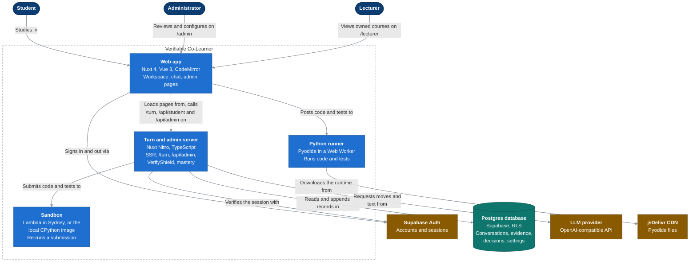

# C4 Level 2: Containers

> [C4 index](README.md) / Level 2: Containers

The application is one Nuxt 4 codebase (`web/`) that runs as two runtime containers: a browser
single-page app (with a Pyodide worker) and a Nitro server. Data and sign-in live in Supabase.

Colours: blue is code in this repo, brown is an external system, teal is a database.

## Containers

| Container | Technology | Responsibility |
|---|---|---|
| Web app | Nuxt 4, Vue 3, Nuxt UI, Tailwind 4, CodeMirror 6 | Renders the workspace (Study and Progress map layouts; the code still calls the second `mindmap`), chat, practice panel, profile, the student sign-up page (`/sign-up`), lecturer editor and preview, About and admin pages. Keeps code drafts on the device and the mindmap with the account. Layout is a cookie. Code in `web/app/`. |
| Python runner | Pyodide 314, Web Worker | Executes the student's code for Run, and runs the tests in the browser when the student submits so the panel can show them at once. Loads the runtime from jsDelivr (`browser-worker.mjs`). Run and that browser check both refuse an import outside the approved list. The browser's counts are not evidence. Code in `web/app/python/`. |
| Sandbox | CPython 3.14 image (`sandbox/`), invoked as Lambda in Sydney on the deployed server | Re-runs a submission with the exercise's tests. The server records only that result (ADR 0010). No network, a fresh child process, and limits of 10 seconds, 512 MB and 64 KB. At most five submissions run at once. |
| Turn and admin server | Nuxt Nitro (`web/server/`) | Also renders pages on the server (SSR) and checks the session before rendering `/sign-in` and `/`. API: `POST /turn` (streamed NDJSON), `POST /api/student`, `POST /api/admin`, `GET /api/admin/security-suite`, `POST /api/admin/security-run` (streamed NDJSON), `GET /api/admin/security-records`, `GET` and `DELETE /api/admin/security-records/:id`, `POST /api/sign-in-code`, `GET /course-outline`, `GET /api/staff/review`. Runs the turn handler, the student handler, the VerifyShield (`verify-shield/`), BKT mastery (`student-model/`), the course (built from the course spec it reads from the database) and the language-model layer. The activity log is written only through the activity recorder. A lecturer or administrator opens one student's records through the staff review, which writes the staff access log first. |
| Postgres database | Supabase Postgres | Tables `courses` (each course's whole course spec plus an unpublished draft, teacher-only content included, readable only with the secret key), `students`, `conversations`, `messages`, `resume_points`, `evidence`, `submissions` (the code, per-test results and outcome of a sandbox check; the owning student can read a row, another student cannot), `quiz_answers`, `module_masteries` (each student's stored mastery per module, ADR 0008), `decisions` (hash-chained; `verify_decision_chain` names the first edited row), `daily_turn_allowances` (at most 60 proposing turns per student per calendar day, server-only), `model_settings`, `verify_shield_settings`, `activity_log`, `staff_access_log` (who opened which student's records, append-only, server-only), `cyber_test_records` (one immutable row per Cyber test run, readable and deletable only by the product owner's routes), `mindmap_positions`, `mindmap_arrangement_resets`, `mindmap_notes`, `mindmap_links`. Written by the server with the secret key, which bypasses RLS. The ledgers (`evidence`, `quiz_answers`, `activity_log`, `submissions`) are append-only. Position, note and link rows, and conversations and messages, are readable by the owning student; the server reads a student's messages through that student's session. Arrangement reset rows are server-only. Profile pictures live in the private Storage bucket `student-files`. Lecturer-uploaded course images live in the public bucket `course-images`, one folder per course, writable only by the course's owner. Student data carries a `course_id` where it belongs to a course. |
| Supabase Auth | Supabase | Email sign-in: a password for staff and seeded students, and a 6-digit email code (valid 5 minutes) for students with an `@student.swin.edu.au` address. `/sign-up` and the student sign-in both use it; Auth makes the account on the first verified code. `POST /api/sign-in-code` refuses any other address before asking Auth to send a code. A trigger on `auth.users` creates the matching `students` row, named from the email when no name is given. |
| LLM provider | OpenAI-compatible API | Both agents call it twice per turn: once to propose a move, once to render text for an approved move. |
| jsDelivr CDN | Public CDN | Serves the Pyodide runtime to the browser. |

## Notes

- The VerifyShield, the agents, the language-model layer and the student model (evidence ledger and BKT estimate) are components inside the server
  container, not separate containers: they are not deployed on their own. See
  [server/00-overview.md](03-components/server/00-overview.md).
- Supabase Postgres and Supabase Auth are drawn as two elements for clarity but belong to the one
  external system "Supabase" in [01-context.md](01-context.md).
- `web/server/python/node-runner.ts` (Pyodide on the server) is imported only by
  `web/tests/python-runner.test.ts`, so it is not drawn. The submission sandbox is the
  container above, not that runner.
- The browser never reads or writes the database. Verified: nothing under `web/app/` calls
  `supabase.from(...)` or creates its own client; the only browser use of `$supabase` is
  `signInWithPassword`, `signOut` and `getClaims`. All data access is in `web/server/storage/`.
  RLS also denies a signed-in student on `students` (`web/tests/students-boundary.test.ts`).
- The browser's `$supabase` client and the server's request client both use the publishable key;
  only the server's storage clients use the secret key.
- Deployment is in [04-deployment.md](04-deployment.md).
