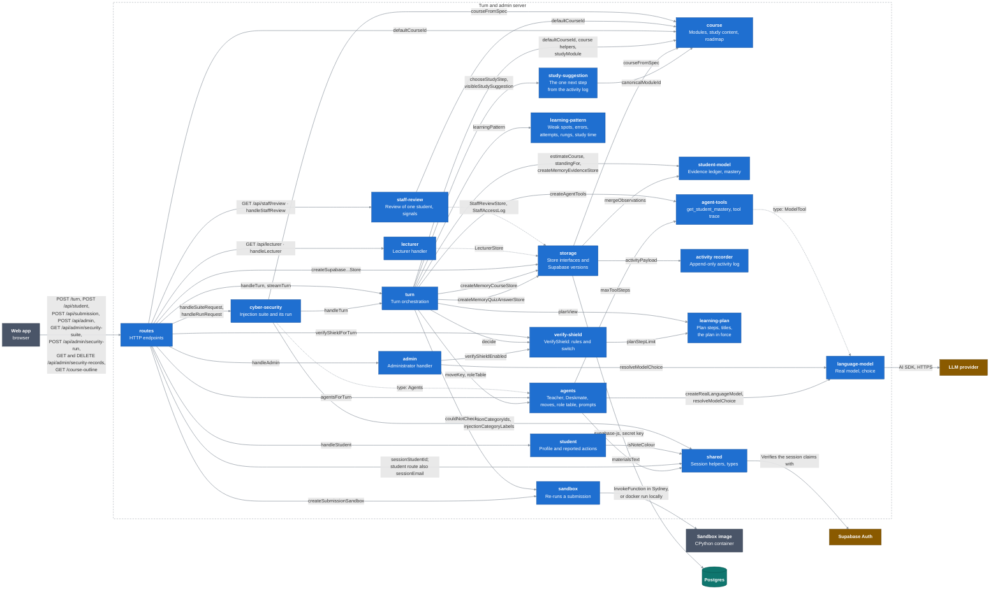

# C4 Level 3: Components of the Turn and admin server

> [C4 index](../../README.md) / Level 3: Components / Turn and admin server

Component-level view of `web/server/` and `web/shared/`. Every arrow below was checked against a real
`import` statement (script over `web/server`, `web/shared`, `web/app`, `web/tests`, `web/e2e`: 553 runtime imports
inside the repo — 496 relative and 57 through a Nuxt alias — 0 unresolved).

Legend: solid arrow = runtime import (the code is called). Thick arrow = runtime link with no import (HTTP call).
Blue = component in this server, grey = another container, brown = external, teal = database.
Type-only imports are erased at build time, so they are listed in the table below instead of drawn.

## Components

| Component | Path | Detail |
|---|---|---|
| routes | `web/server/routes/`, `web/server/api/` | [server/01-routes.md](01-routes.md) |
| turn | `web/server/turn/` | [server/02-turn.md](02-turn.md) |
| verify-shield | `web/server/verify-shield/` | [server/03-verify-shield.md](03-verify-shield.md) |
| course | `web/server/course/` | [server/04-course.md](04-course.md) |
| student-model | `web/server/student-model/` | [server/05-student-model.md](05-student-model.md) |
| agents | `web/server/agents/` | [server/06-agents.md](06-agents.md) |
| language-model | `web/server/language-model/` | [server/07-language-model.md](07-language-model.md) |
| storage | `web/server/storage/` | [server/08-storage.md](08-storage.md) |
| admin | `web/server/admin/` | [server/09-admin.md](09-admin.md) |
| cyber-security | `web/server/cyber-security/` | [server/19-cyber-security.md](19-cyber-security.md) |
| lecturer | `web/server/lecturer/` | [server/10-lecturer.md](10-lecturer.md) |
| student | `web/server/student/` | [server/11-student.md](11-student.md) |
| activity recorder | `web/server/activity-recorder/` | [server/12-activity-recorder.md](12-activity-recorder.md) |
| agent-tools | `web/server/agent-tools/` | [server/13-agent-tools.md](13-agent-tools.md) |
| sandbox | `web/server/sandbox/` | [server/14-sandbox.md](14-sandbox.md) |
| staff-review | `web/server/staff-review/` | [server/15-staff-review.md](15-staff-review.md) |
| learning-pattern | `web/server/learning-pattern/` | [server/16-learning-pattern.md](16-learning-pattern.md) |
| learning-plan | `web/server/learning-plan/` | [server/17-learning-plan.md](17-learning-plan.md) |
| study-suggestion | `web/server/study-suggestion/` | [server/18-study-suggestion.md](18-study-suggestion.md) |
| shared | `web/shared/` | [shared.md](../shared.md) |

## Type-only imports (not drawn)

| From | To | What |
|---|---|---|
| turn | shared, agents, verify-shield, student-model, storage, activity recorder, sandbox, learning-pattern, learning-plan, study-suggestion | `RedrawState` and friends; `Agents`, `Move`, contexts; `Proposal`, `TurnSnapshot`, `Verdict`; `CourseEstimate`, `CourseStanding`, `EvidenceStore`; `ConversationStore`, `DecisionLogStore`, `DailyTurnAllowance`, `SubmissionStore`, `LearningPlanStore`; `ActivityRecorder`; `Sandbox`, `SandboxReport`; `LearningPattern`; `LearningPlan`; `StudyStep` |
| student | activity recorder, storage, shared | `ActivityRecorder`, `ActivityEventType`; `MindmapStore`, `MindmapRecord`, `ProfileStore`, `StudentFileStore`; `NoteColour` |
| verify-shield | agents, learning-plan | `Move`, `RoleTable`; `PlanStep` |
| course | shared, verify-shield, student-model | `RoadmapModule`; `CourseScope`; `CourseStanding` |
| agents | shared, language-model, storage, learning-pattern | `PracticeTestResult`, `RunOutput`, `ModuleMaterials` (in `contexts.ts`); `LanguageModel`, `ModelSettings`; `ModelSettingsStore`; `LearningPattern` |
| storage | verify-shield, student-model, language-model, activity recorder, learning-pattern, learning-plan | `VerifyShieldStore`; `EvidenceStore`, `EvidenceRow`, `TimedObservation`; `ModelSettings`, `ModelSettingsStore`; `ActivityRecorder`; `LearningPattern`; `LearningPlan`, `PlanStep`, `PlanStepKind` |
| learning-plan | shared | `LearningPlanView`, `LearningPlanStepView` |
| study-suggestion | activity recorder, course, shared | `ActivityRow`; `Course`; `StudySuggestionAction`, `StudySuggestionView` |
| admin | storage, language-model, verify-shield | `DecisionLogStore`, `ModelSettingsStore`, `StaffAccessLog`; `ModelSettings`; `VerifyShieldStore` |
| cyber-security | agents, sandbox, shared | `Agents`; `Sandbox`; `InjectionSuiteView`, `InjectionAgent`, `InjectionCategoryId`, `InjectionRunEvent`, `InjectionCaseEvent`, `InjectionRunProvider` |
| staff-review | storage, shared | `StaffReviewStore`, `StaffAccessLog`; `StaffReview` and its parts |

Neither graph has a cycle. language-model imports nothing from agents: agents passes it the proposal schema as an
argument, so the move set is known only to agents.

## Not imported by any runtime code

- `web/server/auth/demo-accounts.ts`: imported only by 6 tests and 6 files under `web/e2e/`. `supabase/seed.sql` repeats the same accounts by hand (its header comment says to keep them aligned).
- `web/server/python/node-runner.ts` and `node-worker.mjs`: imported only by `web/tests/python-runner.test.ts`. See [web-app/05-python-runner.md](../web-app/05-python-runner.md).

## Nitro and Nuxt auto-imports (no import statement)

`defineEventHandler`, `readBody`, `createError`, `sendStream`, `setResponseHeader` and `useRuntimeConfig` are used
in `routes/`, `api/` and `shared/student-id.ts` without an import. They come from Nitro and h3.
