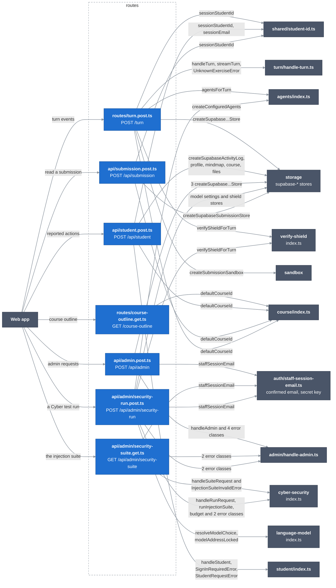

# Component: routes

> [C4 index](../../README.md) / Level 3: Components / Turn and admin server

HTTP endpoints of the server. They only read the session, build the dependencies, call a handler and map
errors to HTTP status codes. Part of [server/00-overview.md](00-overview.md).

Legend: solid = runtime import, thick = HTTP call with no import. Blue = this component, grey = another component.

## Files

| File | Responsibility (from the code) |
|---|---|
| `routes/turn.post.ts` | Returns 401 when there is no session. Navigation events (`select_module`, `select_exercise`, `preview_module`) skip the model and shield reads. `message` and `submission` events are answered as an NDJSON stream; the other events as JSON. Builds the Supabase stores on every request (the model-settings and shield stores only for events that call the model), including the activity log and the daily turn allowance, and passes them to `handleTurn` or `streamTurn`. It also passes the running commit from `server/code-version.ts`, which each decision records. The database, not this route, stamps the course history entry. |
| `api/student.post.ts` | Returns 401 when there is no session and 400 for a rejected report. Builds the activity log, course, profile, mindmap and student-file stores and passes them to `handleStudent`. A preview is not selected here. |
| `api/admin.post.ts` | Builds the admin request once (the confirmed email from the user record, read with the secret key, `adminEmails`, the env model settings, `verifyShield` and five Supabase stores, including the staff access log) and dispatches on the body: a `role` event goes to `checkAdminRole` before the request is built, a `testConnection` event to `handleConnectionTest`, everything else to `handleAdmin`. A JWT email claim, the request body and user metadata are not the email. Maps `SignInRequiredError`, `ProductOwnerRequiredError`, `ModelSettingsError`, `AdminRequestError` and `AdminNotFoundError` to their `statusCode`. |
| `api/staff/review.get.ts` | `GET ?studentNumber=`. Reads the confirmed email, builds the staff review and staff access log stores and calls `handleStaffReview`; maps `StaffReviewError` to its status (401, 403, 404). Sent `Cache-Control: private, no-store`. See [server/15-staff-review.md](15-staff-review.md). |
| `api/admin/security-suite.get.ts` | Reads the confirmed email and the committed suite asset and calls `handleSuiteRequest`: 401 without a session, 403 for anyone but the administrator, and 500 with the full problem list when the suite does not parse or a family is short of fifteen cases. Sent `Cache-Control: private, no-store`. See [server/19-cyber-security.md](19-cyber-security.md). |
| `api/admin/security-run.post.ts` | Reads the confirmed email and the suite asset and calls `handleRunRequest`, answering with 401, 403, 409 when a run is already streaming, or 500 for an invalid suite. The run is returned as NDJSON (`application/x-ndjson`), one run event per line, with buffering turned off; pulling the stream builds the model from the saved settings once, and cancelling it aborts the run and releases the one-run guard. When the stream closes, however it closes, the route's record store writes one Cyber test record; a failed write is logged and does not touch the stream. |
| `routes/course-outline.get.ts` | Public course outline for the About page: number, name, part, summary, availability, of the course read through the Supabase course store. No student data and none of the teacher-only content. |
| `api/submission.post.ts` | Returns 401 when there is no session. With an `id`, returns that submission to the session student, 403 when it belongs to someone else, and 404 when it does not exist. Without an `id`, returns the session student's submissions. |

## Verified imports

- `turn.post.ts`: `shared/student-id`, `agents` (`agentsForTurn`), `course` (`defaultCourseId`), `storage/supabase-conversation-store`, `supabase-decision-log`, `supabase-deskmate-setting-store`, `supabase-daily-turn-allowance`, `supabase-evidence-store`, `supabase-mastery-store`, `supabase-quiz-answer-store`, `supabase-model-settings-store`, `supabase-verify-shield-store`, `supabase-unlock-store`, `supabase-course-store`, `supabase-activity-log`, `supabase-submission-store`, `sandbox` (`createSubmissionSandbox`), `verify-shield` (`verifyShieldForTurn`), `code-version` (`currentCodeVersion`), `turn/handle-turn`.
- `api/submission.post.ts`: `shared/student-id`, `course` (`defaultCourseId`), `storage/supabase-submission-store`, `storage/submission-store` (`SubmissionRefusedError`, `SubmissionNotFoundError`).
- `student.post.ts`: `shared/student-id`, `course` (`defaultCourseId`), `storage/supabase-activity-log`, `supabase-course-store`, `supabase-mindmap-store`, `supabase-profile-store`, `supabase-student-file-store`, `student` (`handleStudent`, `SignInRequiredError`, `StudentRequestError`).
- `admin.post.ts`: `auth/staff-session-email` (`staffSessionEmail`), `admin/handle-admin` (`checkAdminRole`, `handleAdmin`, `handleConnectionTest`, `isConnectionTest`, `isRoleCheck` and the error classes), `course` (`defaultCourseId`), `storage/supabase-decision-log`, `supabase-model-settings-store`, `supabase-staff-access-log`, `supabase-student-directory`, `supabase-verify-shield-store`.
- `staff/review.get.ts`: `auth/staff-session-email`, `staff-review` (`handleStaffReview`, `StaffReviewError`), `storage/supabase-staff-review-store`, `supabase-staff-access-log`.
- `admin/security-suite.get.ts`: `admin/handle-admin` (`SignInRequiredError`, `ProductOwnerRequiredError`), `auth/staff-session-email`, `cyber-security` (`handleSuiteRequest`, `InjectionSuiteInvalidError`).
- `admin/security-run.post.ts`: `agents` (`createConfiguredAgents`), `language-model` (`modelAddressLocked`, `resolveModelChoice`), `storage/supabase-model-settings-store`, `supabase-verify-shield-store`, `supabase-cyber-test-record-store`, `verify-shield` (`verifyShieldForTurn`), `auth/staff-session-email`, `cyber-security` (`handleRunRequest`, `injectionRunBudgetMs`, `InjectionRunInProgressError`, `InjectionSuiteInvalidError`, `runInjectionSuite`), `admin/handle-admin` (`SignInRequiredError`, `ProductOwnerRequiredError`), `shared/injection-suite` (type).
- `course-outline.get.ts`: `course` (`defaultCourseId`), `storage` (`supabase-course-store`).
- `turn.post.ts` names the course of the turn (`defaultCourseId`: every student is enrolled in the Python course in sprint 1), creates the stores of student data for that course, including the store of stored mastery (ADR 0008), and passes the Supabase course store, the course id and the running commit to the turn handler.
- Auto-imported, no import statement: `defineEventHandler`, `readBody`, `createError`, `sendStream`, `setResponseHeader`, `useRuntimeConfig`.

## Tests

No test imports these files. `turn-endpoint.test.ts` tests `handle-turn.ts` directly, not the route.
