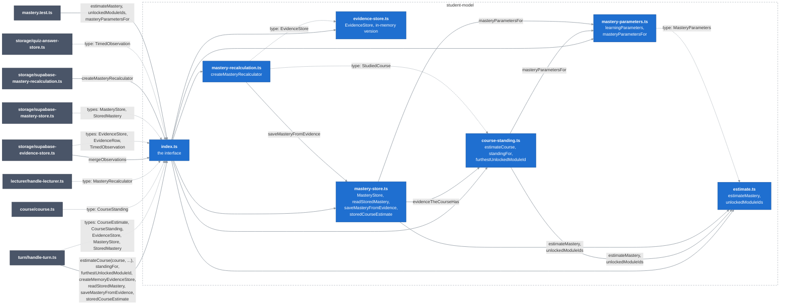

# Component: student-model

> [C4 index](../../README.md) / Level 3: Components / Turn and admin server

`web/server/student-model/`, where this student stands on the course. The evidence ledger holds what the student
submitted; the estimate turns it into one mastery per module (Bayesian Knowledge Tracing) and the set of modules that
are open. That result is also *stored*, one row per student, course and module, and every reader shows the stored copy
(ADR 0008): the turn handler writes it from new evidence, and the recalculator rewrites it for every enrolled student
when the course itself changes. This is the mastery half of M6 in the research documents. Everything outside the
folder goes through `index.ts`. Part of [server/00-overview.md](00-overview.md).

Legend: solid = runtime import, dashed = type-only import. Blue = this component, grey = other components.

## Files

| File | Responsibility |
|---|---|
| `estimate.ts` | Pure Bayesian Knowledge Tracing and the unlock rule. `estimateMastery(evidence, moduleIds, parameters)`: one update per observation, in ledger order. For an exercise submission, the first pass counts and marks the module's `passedExercise`; once an exercise is passed, later submissions on it — passes and failures alike — stop being observations, so experimenting on a finished exercise never moves mastery. A `quiz_answer` observation always counts but never marks a passed exercise. `everMastered` is set only when mastery reaches the threshold **and** the module has a passed exercise, so understanding alone never masters a module. `unlockedModuleIds(modules, estimated)`: a straight, permanent chain, where the first available module is open and each later one opens once the one before it has ever been mastered; a module with `available: false` stays closed. |
| `mastery-parameters.ts` | `learningParameters` (`prior` 0.1, and slip/guess/learning by observation kind: submission 0.1/0.2/0.15 and quiz answer 0.1/0.25/0.05, so one passed exercise takes a module from 0.1 to 0.433 and one correct answer only to 0.321), the one place they are written down, and `masteryParametersFor(threshold)`, which adds a course's mastery threshold. The threshold itself belongs to the course spec. |
| `course-standing.ts` | `estimateCourse(course, evidence, recordedUnlocks)` computes mastery from the evidence and current threshold, then combines earned and recorded unlocks. It returns modules with a passed exercise and skips evidence for removed content. `standingFor` adds the current module and `furthestUnlockedModuleId` picks the starting module when there is no resume point. `evidenceTheCourseHas` drops the evidence about content the course no longer has, which the stored copy uses the same way. |
| `mastery-store.ts` | The stored copy (ADR 0008): `MasteryStore` (`forStudent(studentId)`, `save(studentId, masteries)`, which replaces the student's whole picture) with its in-memory version, `StoredMastery` (the same shape as `ModuleMastery`), and the three reads and writes the turn handler makes. `readStoredMastery` returns the stored rows, rebuilding and saving them from evidence first when a module of the course has no row. `saveMasteryFromEvidence` runs the estimate over the ledger and saves what it gives: the only way the number changes. `storedCourseEstimate(course, stored, recordedUnlocks)` turns the rows into the `CourseEstimate` every reader shows, leaving out rows for modules the course no longer has and opening a module because its row says it was ever mastered or because the unlock was recorded. |
| `mastery-recalculation.ts` | `createMasteryRecalculator(sources)` is the other trigger for a recompute (ADR 0008): a change to the course itself. Given the course as it now is, who is enrolled, and the evidence and mastery stores of a named course, `forCourse(courseId)` opens those two stores for that course and recomputes and saves every enrolled student's picture, so a change to one course never reads or writes another's rows. The lecturer handler calls it after a publish or a threshold change, and `web/scripts/recalculate-mastery.ts` calls it once for every course when the mastery parameters change (run with `pnpm dlx tsx scripts/recalculate-mastery.ts` and the Supabase URL and secret key; unlocks are kept, ADR 0005). |
| `unlock-store.ts` | Append-only unlocks for a student. The Supabase adapter scopes records to the course. |
| `evidence-store.ts` | The server-side evidence ledger combines submissions and quiz answers. `EvidenceStore` (`append`, `forStudent`), `NewEvidence`, `EvidenceRow`, `TimedObservation` (an observation with the time it was recorded), `mergeObservations` (one timestamp-ordered stream from both sources, used by the Supabase adapter) and an in-memory version. Submissions append through the evidence store. The quiz-answer store records the first answer to each question. |
| `index.ts` | The interface: `estimateMastery`, `unlockedModuleIds`, `learningParameters`, `masteryParametersFor`, `estimateCourse`, `standingFor`, `furthestUnlockedModuleId`, `createMemoryEvidenceStore`, `mergeObservations`, `createMemoryMasteryStore`, `readStoredMastery`, `saveMasteryFromEvidence`, `storedCourseEstimate`, `createMasteryRecalculator`, and the types `MasteryParameters`, `ModuleMastery`, `Observation`, `UnlockableModule`, `CourseEstimate`, `CourseStanding`, `StudiedCourse`, `StudiedModule`, `EvidenceStore`, `EvidenceRow`, `NewEvidence`, `TimedObservation`, `MasteryStore`, `StoredMastery`, `MasteryRecalculator`, `MasteryRecalculationSources`. |

The Supabase version of the ledger stays in [`storage`](08-storage.md) (`supabase-evidence-store.ts`), so the code that
depends on Supabase stays in one place. From here it takes the `EvidenceStore`, `EvidenceRow` and `TimedObservation`
types and, at runtime, `mergeObservations`, which it uses to merge its two tables into one stream.
`storage/quiz-answer-store.ts` takes the `TimedObservation` type. The stored mastery is the same arrangement:
`storage/supabase-mastery-store.ts` implements `MasteryStore` against `module_masteries`, and
`storage/supabase-mastery-recalculation.ts` builds the recalculator from the Supabase stores for the two lecturer
routes, so nothing outside `storage` names a table.

## Verified imports

- Imports: none outside its own files. It does not import `course`: `estimateCourse` and `furthestUnlockedModuleId` take the course as an argument, and read only its mastery threshold and each module's `id`, `available`, `exerciseIds` and `questionIds`. The estimator accepts observations tagged as `submission` or `quiz_answer`. Only a passing submission counts as a passed exercise.
- Runtime importers, through `index.ts`: `turn/handle-turn.ts`, `storage/supabase-evidence-store.ts` (`mergeObservations`), `storage/supabase-mastery-recalculation.ts` (`createMasteryRecalculator`).
- Type-only importers: `turn/handle-turn.ts` (`CourseEstimate`, `CourseStanding`, `EvidenceStore`, `MasteryStore`, `StoredMastery`), `course/course.ts` (`CourseStanding`), `lecturer/handle-lecturer.ts` (`MasteryRecalculator`), `storage/supabase-evidence-store.ts` (`EvidenceStore`, `EvidenceRow`, `TimedObservation`), `storage/supabase-mastery-store.ts` (`MasteryStore`, `StoredMastery`), `storage/quiz-answer-store.ts` (`TimedObservation`).
- Tests: `mastery.test.ts` and `course-roadmap.test.ts` (both also import `course`); `stored-mastery.test.ts` (the store, the read that rebuilds a missing row and the recalculator); `turn-endpoint.test.ts` and `admin-handler.test.ts` reach it through `handle-turn.ts`.

## Notes

- Mastery is derived from evidence alone (ADR 0002) and, once earned, kept in the database (ADR 0008). This component does not read or write that table: it offers the `MasteryStore` interface, and `storage` implements it. The turn handler is the only writer on a student's own evidence, the recalculator the only writer for a change to the course, and nothing else may change the number: no event the student handler accepts is evidence, which `student-handler.test.ts` pins down.
- A recompute can turn a mastered module back to open but never closes one whose unlock was recorded (ADR 0005), because `storedCourseEstimate` unions the stored rows' `everMastered` chain with the recorded unlocks.
- The resume point (which module the student was on) is not here. `storage/conversation-store.ts` keeps it, because it belongs to the conversation, not to what the student knows.
- The other half of M6, the misconception state (which principles the student's code broke), is not in the code. `TeacherContext` carries `misconceptionResponses`, but those are fixed course content, not per-student state.
- `ModuleMastery` here (`moduleId`, `mastery`, `passedExercise`, `everMastered`) is a different type from `ModuleMastery` in `verify-shield` (`moduleId`, `mastery`). Both are exported under the same name from their own component.
