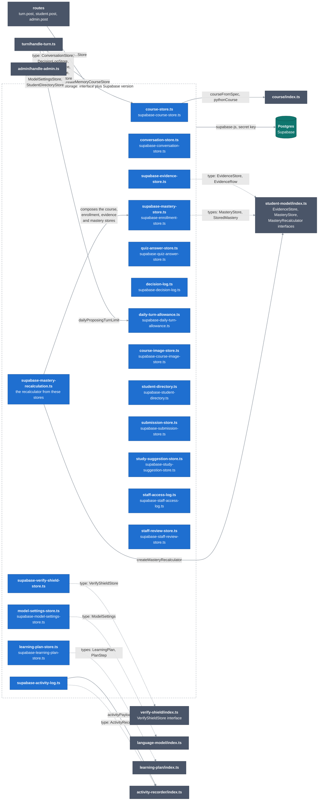

# Component: storage

> [C4 index](../../README.md) / Level 3: Components / Turn and admin server

Persistence behind interfaces. Each store has an interface with an in-memory version, and a Supabase version
that talks to Postgres. The course store reads a course's stored course spec; the stores of student data
(conversation, evidence, quiz answers, module unlocks, stored mastery, learning plans, decision log) are each created for one course
and read and write only its rows. The daily turn allowance belongs to the student for a calendar day, across courses.
Part of [server/00-overview.md](00-overview.md).

Legend: solid = runtime import, dashed = type-only import. Blue = this component, grey = other components, teal = database.

Each box is a pair of files: the interface file (with its in-memory version) and the `supabase-` file that
implements it with `import type` from the interface file. The verify shield, evidence, stored mastery and activity log are the exceptions: their interface
files are in the `verify-shield`, `student-model` and `activity-recorder` components, so only the `supabase-` file is here.
`supabase-mastery-recalculation.ts` is not a store either: it builds `student-model`'s recalculator out of the course,
enrollment, evidence and mastery stores, so the two lecturer routes each get one object to call after a change. It takes
only the connection, never a course id: each `forCourse` call opens the evidence and mastery stores of the course it is
asked to recompute, because those stores are scoped to one course.
## Stores and the tables they use

| Store | Interface offers | Tables (from the Supabase version) |
|---|---|---|
| course | `course(courseId)`: the course built from its stored spec with `courseFromSpec`; throws for an unknown id. Read on every call, so an imported spec applies on the next request. The in-memory version holds `pythonCourse` unless given others. | `courses` |
| conversation | `displayName`, `resumePoint`, `saveResumePoint`, `messages`, `appendMessage`. One resume point per student per course. `messages` reads through `reader`, the signed-in student's own Supabase client, so RLS returns nothing of another student even when the request names one; the rest uses the secret key. Each stored message carries `createdAt`, the time the database stamped it on insert, or `null` for messages written before times were recorded, and `addressedAgent` (`teacher`, `deskmate` or `null`; only a student message has one). | `students`, `resume_points`, `conversations`, `messages` |
| evidence | `append`, `forStudent` (attempt number is assigned by a database trigger). Reads merge submissions with quiz answers by timestamp. Only the Supabase version is here; the interface and the in-memory version live in [`student-model`](05-student-model.md). | `evidence` |
| quiz answers | `record` (keeps the first answer per student, module and question; a second returns the first unchanged), `forStudentModule`, and `observationsForStudent` for the evidence store. Interface and in-memory version in `quiz-answer-store.ts`. | `quiz_answers` |
| activity log | `record`, `forStudent` (the student's events oldest first, as `time`, `type`, `moduleId` from the payload, and the payload — what the [learning pattern](16-learning-pattern.md) computes from). Drops `code`, `draft` and `keystrokes` before insert. The event types and the in-memory log live in [`activity-recorder`](12-activity-recorder.md); only the Supabase adapter is here. The adapter does not send a time; `created_at` is the database clock. | `activity_log` |
| submissions | `record`, `forStudent`, `latestForExercise`, `read`. Keeps the code, the per-test results, the findings (misconception ids the code showed), the outcome (`passed`, `failed` or `refused`) and `createdAt` (the sandbox check's finish, the database clock on insert). `latestForExercise` returns the most recent stored submission for a student, module and exercise, which is where the turn reads the findings a submission turn did not compute itself. `read` returns the row to its owner and refuses any other student. The interface and the in-memory version are in `submission-store.ts`. | `submissions` |
| staff access log | `record` (who, role, student, course, what) and `list` (newest first, with the student number). Rows are only added; only the server reads them, for the administrator. Interface and in-memory version in `staff-access-log.ts`. | `staff_access_log`, `student_directory` view |
| cyber test records | `record` writes one row per Cyber test run when the run's stream closes: start time, duration, provider, model label, shield state, how it stopped (`complete`, `budget` or `cancelled`), suite version, total and finished cases, passed and leaked, the score (null when no case finished) and the case results in the same shape the run streamed. Only the server writes it, and the run request logs and ignores a failed write. A row is never updated; deleting one comes with the administrator's history page and a product-owner route. Interface and in-memory version in `cyber-test-record-store.ts`. | `cyber_test_records` |
| staff review | `studentByNumber`, `ownedCourseOf` (the course a lecturer owns that the student is enrolled in), `activity`, `submissions`, `conversations`. Reads a student's records with the secret key for the [staff-review](15-staff-review.md) component, which decides who may call it; the conversation is read here, not through the student's own session. Interface and in-memory version in `staff-review-store.ts`. | `student_directory` view, `courses`, `enrollments`, `activity_log`, `submissions`, `conversations`, `messages` |
| decision log | `append`, `list` (newest 100, filter by verdict and student), `chain` (`verified` or `broken`). Each record carries the verdict's ordered `ruleChecks` (`rule_checks` jsonb column). A row recorded before that column existed holds null and reads back with `ruleChecks` absent, which is different from the empty list of a shield-off decision. Each record has an `outcome` (`outcome` column): `ruled`, with the VerifyShield's verdict, rule and reason, or `step_cap`, when the Teacher reached its tool step cap, with all three null (a check constraint holds this). Each record also carries the turn's `addressedAgent` (`addressed_agent` column; null when no agent was addressed, and on rows from before it), and, when the turn passed them, `codeVersion` and `courseHistoryId`. Each record also carries the turn's module id and the learning pattern snapshot the Teacher saw (`module_id`, `learning_pattern` jsonb column; both null on rows from before they were recorded, kept for audit against the hash chain). The database sets `content_hash` and `previous_hash` on insert and does not return them. `chain` calls `verify_decision_chain`, which walks every decision in id order from the starting previous hash `genesis` and returns the first broken row, or null. | `decisions` |
| deskmate setting | `read(studentId)` (true when no row), `save(studentId, on)`. One switch per student, not scoped to a course. Only the server reads it, for the session student. Interface and in-memory version in `deskmate-setting-store.ts`. | `deskmate_settings` |
| daily turn allowance | `take(studentId, day)` reserves one proposing turn for that `YYYY-MM-DD` and returns false once 60 are taken. The turn handler passes the Hanoi calendar day. Not scoped to a course. Interface and in-memory version in `daily-turn-allowance.ts`. The Supabase version calls `take_daily_proposing_turn`, which inserts or increments in one statement and never stores a count above 60. Only the server can call it. | `daily_turn_allowances` |
| lecturer | Reads owned course titles, enrollment counts, thresholds and history. Saves threshold and history together. | `courses`, `enrollments`, `course_history` |
| module unlocks | Reads and records unlocked module IDs for one student and course. | `module_unlocks` |
| stored mastery | `forStudent(studentId)` and `save(studentId, masteries)`, which clears the student's rows for the course and inserts the new picture, so a module the course no longer has leaves no row. Only the Supabase version is here; the interface, the in-memory version and every rule about when the number changes live in [`student-model`](05-student-model.md). | `module_masteries` |
| enrollments | `enrolledStudentIds(courseId)`: who is learning the course, which is who a publish or a threshold change recomputes stored mastery for. The interface is in the Supabase file, because the lecturer store reads the same table for its own counts. | `enrollments` |
| model settings | `read`, `save` (single row, id 1) | `model_settings` |
| study suggestion dismissals | `dismissed(studentId)`: the activity row each dismissed step was last dismissed at, by step identity; `dismiss(studentId, identity, anchor)` remembers one, replacing an earlier dismissal of the same step. Scoped to one course. A dismissal is not evidence and the student never reads or writes it directly: only the turn handler does. The interface and the in-memory version are in `study-suggestion-store.ts`. | `study_suggestion_dismissals` |
| learning plans | `latest(studentId, moduleId)`: the highest revision for that student and module, or null; `append(studentId, plan)` writes one more revision, never updating a stored one, so agreeing is a new row with `agreedAt`; the store stamps `createdAt` (the database clock), and a revision carries its `trigger` and `decisionTurnId`. Stored steps are checked on the way back (`kind` in the six, a string `ref`). The interface and the in-memory version are in `learning-plan-store.ts`. | `learning_plans` |
| course images | `put(courseId, name, image)` stores a lecturer's image and returns the address a browser loads it from. The Supabase version writes to the public `course-images` bucket with the server key and never overwrites. | Storage bucket `course-images` |
| student directory | `list`: each student's id, display name, student number, email and campus. `changeCampus`: `changed`, `unchanged` or `not-found`; the Supabase version calls `set_student_campus`, which writes the `campus_changes` history row. `changeNumber`: `changed`, `unchanged`, `duplicate` (another student holds it), `used` (a different student had it before), or `not-found`. The Supabase version calls the `set_student_number` function, which locks the row, keeps the number's first assignment in the write-once assignments table and writes the history row; the student's own earlier number may be restored, no other student's may. `deleteStudent`: `deleted` or `not-found`; the Supabase version removes the student's files from the `student-files` bucket (`<id>/` and `<id>/notes/`), then calls `delete_student_records` (below). | `students`, `student_directory` view, `student_number_changes`, `private.student_number_assignments` |
| verify shield | `read`, `save`. Only the Supabase version is here; the interface, the in-memory version and the `verifyShieldEnabled` / `verifyShieldForTurn` rules live in [`verify-shield`](03-verify-shield.md). | `verify_shield_settings` |

## Verified imports

- The Supabase stores use `@supabase/supabase-js` and import their store interfaces. The evidence adapter also calls the quiz-answer adapter and merges the observations using `student-model/index.ts`. The mastery adapter type-imports `MasteryStore` and `StoredMastery` from `student-model/index.ts`, and `supabase-mastery-recalculation.ts` calls `createMasteryRecalculator` there and the course, enrollment, evidence and mastery adapters here. The activity adapter imports `activityPayload` from `activity-recorder` and type-imports `ActivityRecorder`.
- The course store imports `course` (`courseFromSpec` in the Supabase version, `pythonCourse` in the in-memory one).
- Runtime importers from outside: `routes/turn.post.ts` (the turn stores, including `supabase-activity-log`, `supabase-deskmate-setting-store`, `supabase-daily-turn-allowance`, `supabase-mastery-store`, `supabase-submission-store`, `supabase-learning-plan-store` and `supabase-study-suggestion-store`), `api/submission.post.ts` (`supabase-submission-store`), `api/lecturer.post.ts` and `api/lecturer/spec.post.ts` (`supabase-mastery-recalculation`), `api/student.post.ts` (`supabase-activity-log`, `supabase-course-store`, plus the profile, mindmap and student-file stores), `routes/course-outline.get.ts` (`supabase-course-store`), `api/admin.post.ts` (five Supabase files, including `supabase-student-directory` and `supabase-staff-access-log`), `api/admin/security-run.post.ts` (`supabase-cyber-test-record-store`), `api/staff/review.get.ts` (`supabase-staff-review-store`, `supabase-staff-access-log`). `turn/handle-turn.ts` also imports `quiz-answer-store.ts` and `course-store.ts` at runtime for their in-memory defaults, and `dailyProposingTurnLimit` from `daily-turn-allowance.ts`. It type-imports `SubmissionStore`.
- Type-only importers: `turn/handle-turn.ts` (`conversation-store`, `decision-log`, `daily-turn-allowance` (`DailyTurnAllowance`), `learning-plan-store` (`LearningPlanStore`), and the `QuizAnswerStore`/`QuizAnswerRow` types), `admin/handle-admin.ts` (`decision-log`, `model-settings-store`, `student-directory`), `agents/configured-agents.ts` (`model-settings-store`).
- Tests: `message-time-migration.test.ts` (the `messages.created_at` migration, on PGlite); `student-numbers-migration.test.ts` (the student number backfill and the change function, on PGlite); `activity-log-migration.test.ts` (the activity log is append-only, stamps its own time, and refuses `anon` and `authenticated`, on PGlite); `stored-mastery-migration.test.ts` (one row per student, course and module, the mastery range, and that no non-server role reads or writes it, on PGlite); `table-grants-migration.test.ts` (anon and authenticated hold no privileges on the older tables, bar a student's select on their conversation, on PGlite); `own-conversation-migration.test.ts` (a student reads only their own conversations and messages, on PGlite); `daily-turn-allowance-migration.test.ts` (60 proposing turns per student per day, the next day and another student are separate, and no non-server role reads the table or calls the function, on PGlite); `decision-hash-chain-migration.test.ts` (the database sets each decision's hashes from `genesis`, covers rows already stored, and `verify_decision_chain` names the edited row, on PGlite); `courses-boundary.test.ts`, `conversation-storage.test.ts`, `decisions-boundary.test.ts`, `model-settings-boundary.test.ts`, `quiz-answers-boundary.test.ts`, `student-numbers-boundary.test.ts`, `activity-mindmap-boundary.test.ts` (Supabase versions, against the live project); `turn-endpoint.test.ts`, `daily-turn-limit.test.ts`, `admin-handler.test.ts`, `quiz-answer.test.ts`, `wrong-quiz-brings-agents.test.ts`, `move-contract.test.ts`, `prompt-hardening.test.ts`, `real-language-model.test.ts`, `student-handler.test.ts` (the interfaces and their in-memory versions). `staff-access-log-migration.test.ts` (the staff access log is append-only, closed to `anon` and `authenticated`, and survives deleting the student, on PGlite). `submission-migration.test.ts` (the submissions table is append-only and closed to anon and authenticated, on PGlite), `learning-plans-migration.test.ts` (revisions, the unique key, and no non-server role reads or writes, on PGlite) and `sandbox-submission.test.ts` (the in-memory submission store), `learning-plan-turn.test.ts` (the in-memory learning plan store).

## Notes

- Every row of `evidence`, `quiz_answers`, `conversations`, `resume_points`, `module_unlocks`, `module_masteries` and `decisions` carries a required `course_id` (rows from before were backfilled with `intro_python`). The Supabase stores of student data take a `courseId` when created, write it on every insert and filter every read by it, so their interfaces carry no course.
- `courses` holds one row per course: its id, title and whole course spec as `jsonb`. The spec includes teacher-only content (hint ladders, misconception responses, reference solutions, the correct quiz choices), so RLS is on with no policy and every privilege is revoked from anon and authenticated; only the secret key reaches it. The migration that created the table inserted the Python course, so a fresh database has it.
- Each Supabase file creates its own client with the same options (secret key, no session). They share no helper, so the setup is repeated, and `routes/turn.post.ts` creates the turn stores again on every request (each `createSupabase...Store` call makes a new client).
- `course-images` is a public bucket. Its policies let `authenticated` read and only the course's owner (`public.owns_course` on the folder name) insert, update or delete (`course-images-migration.test.ts`, on PGlite).
- `students.campus` is null until the student chooses one of Hanoi, Da Nang, Ho Chi Minh City or Can Tho. `public.choose_student_campus` sets it only when it is null; `public.set_student_campus` is the administrator's change and records actor, old and new value in `campus_changes`. Both are executable only with the server key (`student-campus-migration.test.ts`, on PGlite). The profile store reads the campus and offers `chooseCampus`; it has no way to change one.
- `students.student_number` is unique when present and null for staff. A BEFORE INSERT trigger takes the next value from `private.student_number_seq`, formats `SWB` plus at least four digits and writes it to `private.student_number_assignments` before stamping the row; the assignments table is write-once and the sequence skips any number already recorded there, so a number is never handed out twice. The migration backfilled existing students in sign-up order (`auth.users.created_at`). `public.set_student_number` is the only way to renumber, is executable only with the server key, and records the actor, old and new value in `student_number_changes` in the same statement. The `student_directory` view joins the profile to its account for the email, leaves out staff, and is granted only to `service_role`.
- The decision log, evidence and quiz-answers tables have no RLS policy, so only the server's secret key can read or write them. On insert a trigger hashes the decision and chains it to the previous row (`content_hash`, `previous_hash`), taking one advisory lock so two inserts cannot share a predecessor. `public.verify_decision_chain` is executable only by `service_role`. `code_version` is what the server sends; `course_history_id` is the latest course history row for that course at insert, and for a row already stored, the entry in force when it was recorded. The administrator's list does not select the hashes. `20261119080000_revoke_broad_table_grants.sql` revokes every privilege on the older tables (`students`, `conversations`, `messages`, `resume_points`, `model_settings`, `verify_shield_settings`, `decisions`, `evidence`, `quiz_answers`) from `public`, `anon` and `authenticated`, so a later policy cannot hand those tables to a student. `service_role` keeps its grants. `20261119150000_student_reads_own_conversation.sql` then grants `select` on `conversations` and `messages` back to `authenticated` with policies matching `auth.uid()` (a message through its conversation), so a student reads only their own conversation and writes none (`own-conversation-migration.test.ts`, on PGlite). `quiz_answers` keeps only the first answer through a `unique (student_id, course_id, module_id, question_id)` constraint. `activity_log` is the same kind of ledger: `course_id` may be null, update and delete are revoked from every role, and a check rejects a payload that carries `code`, `draft` or `keystrokes`. `anon` and `authenticated` have no privileges on it. `staff_access_log` is a ledger of the same kind: update and delete are revoked from every role, `student_id` has no foreign key so deleting a student leaves the record of who looked, and a check limits `actor_role` to `administrator` or `lecturer`. `20261120000000_delete_student_records.sql` adds `public.delete_student_records(target)`, executable only by `service_role`: it clears the rows with no foreign key (`decisions`, `activity_log`, `staff_access_log`, `campus_changes`, `student_number_changes`), then deletes the `auth.users` row, which cascades to `students` and every table that references it (submissions, learning plans and their revisions, evidence, quiz answers, conversations, notes, enrolments). It is the only way those ledgers lose rows, and it removes every row of one student and none of another's. Each decision that followed a removed one is relinked to the decision before it, leaving `content_hash` alone, so the chain still verifies and a row that was edited still shows. `private.student_number_assignments` stays, so a retired number is never given out again. The same migration revokes `update` from `service_role` on `evidence`, `quiz_answers` and `decisions`; `delete` stays for the demo reset. `delete-student-records-migration.test.ts` pins this on PGlite.
- `module_masteries` (ADR 0008) is keyed `(student_id, course_id, module_id)`, checks `mastery` between 0 and 1 and defaults `passed_exercise` and `ever_mastered` to false. RLS is on with no policy and every privilege is revoked from `anon` and `authenticated`, so the number a student sees is only ever what a server-side recompute wrote; `service_role` also holds delete, because a save replaces the picture. The table arrives with this change, so those privileges are pinned by `stored-mastery-migration.test.ts` on PGlite rather than a boundary test against a project that has the table.
- `submissions` keeps one row per sandbox check: the code, the per-test results, the findings (a `jsonb` array of misconception ids the code showed, empty when it showed none) and the outcome. A refused row must carry a message; a passed or failed row must not. RLS is on with no policy. `anon` and `authenticated` have no privileges. `service_role` may select and insert, not update or delete, so a stored submission is not edited. Deleting the student removes the rows. `submission-migration.test.ts` pins that on PGlite. The owning student reads a row through `POST /api/submission`; `read` refuses any other student.
- `study_suggestion_dismissals` keeps one row per student, course and step: `step` is the step's identity (situation, module, exercise and error type), `anchor` the id of the `activity_log` row its episode was anchored on when dismissed, and `dismissed_at`. The primary key is `(student_id, course_id, step)`, so a later dismissal of the same step replaces the earlier one. RLS is on with no policy; every privilege is revoked from `public`, `anon` and `authenticated`, and `service_role` may select, insert and update. Deleting the student or the course removes the rows. `study-suggestion-migration.test.ts` pins that on PGlite.
- `cyber_test_records` keeps one immutable row per Cyber test run: the run's start time, duration, provider, model label, shield state, how it stopped (`complete`, `budget` or `cancelled`), suite version, total and finished cases, passed and leaked, the score (null when no case finished, never zero) and the case results as a `jsonb` array in the streamed shape. Checks keep the counts consistent (`passed + leaked = finished_cases`, `finished_cases <= total_cases`), the score between 0 and 1, and `cases` an array. RLS is on with no policy; every privilege is revoked from `public`, `anon` and `authenticated`, and `service_role` may only select and insert, so a stored record is not edited; deleting one arrives with the administrator's history page. There is no foreign key to a student, so deleting a student's records leaves the test records alone. `cyber-test-records-migration.test.ts` pins the constraints and grants on PGlite, and `cyber-security-run.test.ts` covers the record built from the stream with an in-memory store.
- `learning_plans` keeps one row per revision of a student's plan for a module: `student_id`, `course_id`, `module_id`, `revision` (at least 1), `steps` as a `jsonb` array, `current_step` (at least 0) and `agreed_at` (null until the student starts it), `trigger` and `decision_turn_id` (what brought the revision about and the turn whose decision ruled on it; both null on a first proposal and on older rows). A unique index on `(student_id, course_id, module_id, revision)` makes two rows with the same revision impossible, and the store only inserts, so a stored revision is never rewritten. RLS is on with no policy; every privilege is revoked from `public`, `anon` and `authenticated`, and `service_role` may select and insert only. `learning-plans-migration.test.ts` pins that on PGlite. Deleting the student or the course removes the rows.
- `daily_turn_allowances` is keyed `(student_id, day)` and is not scoped to a course. `taken` is between 1 and 60. RLS is on with no policy and every privilege is revoked from `anon` and `authenticated`. `public.take_daily_proposing_turn` is the only writer: it inserts the first turn or increments the row in one statement, returns false once the day holds 60, and is executable only by `service_role`. Those privileges are pinned by `daily-turn-allowance-migration.test.ts` on PGlite. Deleting the student removes the rows.
