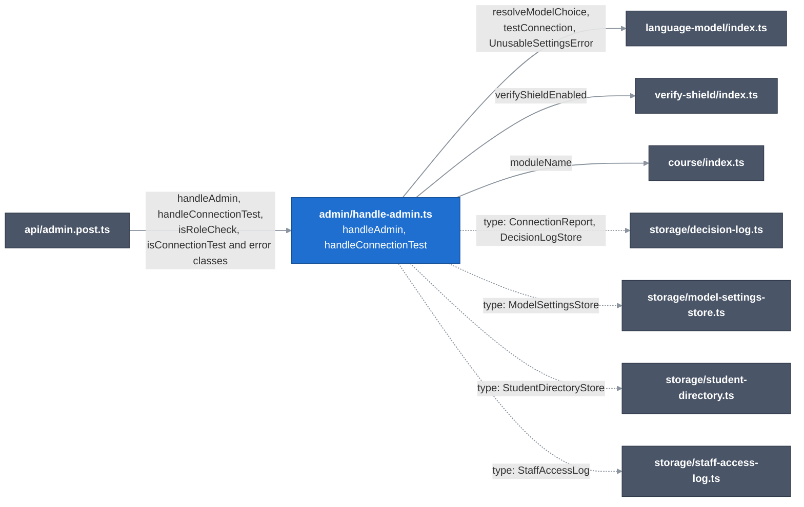

# Component: admin

> [C4 index](../../README.md) / Level 3: Components / Turn and admin server

`web/server/admin/handle-admin.ts`, one file. The administrator's handler: it checks who is asking, then saves
the model choice, tests the connection, switches the VerifyShield, lists decisions, lists, renumbers or deletes students and lists the staff access log. Part of
[server/00-overview.md](00-overview.md).

Legend: solid = runtime import, dashed = type-only import. Blue = this component, grey = other components.

## Behaviour (from the code)

| Step | What happens |
|---|---|
| Who may call | No confirmed email: `SignInRequiredError` (401). Email not in the comma-separated `adminEmails`: `ProductOwnerRequiredError` (403). The route supplies the email from the user record. |
| `role` event | `checkAdminRole`: the same 401/403 checks, then `{ productOwner: true }`. Reads no settings and no decisions; `api/admin.post.ts` routes it there before `handleAdmin`. |
| `testConnection` event | `handleConnectionTest`: the same 401/403 checks, then the two provider calls of [`language-model`](07-language-model.md) with the settings on the form — the same merge a save makes, so a blank field is the value in effect and not an empty one. It answers `{ reply, toolCall }`, each with success, the time it took and the provider's message with the API key taken out. Nothing is saved and no store is written; a blank or `fake` form is refused (400) before a call is made. `api/admin.post.ts` routes it here, so the answer carries no decisions and no directory. |
| `save` event | Validates the provider with `resolveModelChoice`, keeps the current API key if the new one is blank, and stores the settings. In production a real base URL other than `https://api.deepseek.com` is a 400 and nothing is stored. |
| `verifyShield` event | Saves the on or off switch. |
| `studentNumber` event | Checks the number against `isStudentNumber` in `shared/student-number.ts` (`SWB` + at least four digits, 400 with `studentNumberRule` otherwise) before reading the directory, then asks the store to change the number: an unknown student is 404, a number another student holds or one a student had before is 400. The store writes the change record with the acting administrator's email. |
| `deleteStudent` event | Asks the student directory to delete the student and every record of theirs (404 if the student is unknown, 400 if `studentId` is missing) and answers with the students who remain. Only an administrator reaches it. The cascade lives in the database function `delete_student_records` ([storage](08-storage.md)). |
| `staffAccessLog` event | Returns `staffAccess`: the newest 200 openings of a student's records by staff, with who, their role, the student number, what was opened and when; a conversation opening also carries the module's name from the course store (its id when the course no longer lists it). Only an administrator reaches it (the same 401/403 checks), so a lecturer or a student cannot read the log. Every other call returns it empty and reads nothing. |
| Every other call | Returns the model settings with the API key masked, the current shield state, up to 100 decisions filtered by verdict and student id, and `chain`: `verified` or `broken`. The broken row's id is not in the answer. `students` is empty unless the body's `event` is `students`, `studentNumber`, `campus` or `deleteStudent`, so no other call reads the directory. |

## Verified imports

- Runtime: `language-model` (`resolveModelChoice`, `modelAddressLocked`, `testConnection`, `UnusableSettingsError`; types `ModelSettings`, `ConnectionReport`), `verify-shield` (`verifyShieldEnabled`; type `VerifyShieldStore`), `course` (`moduleName`), `shared/student-number` (`isStudentNumber`, `studentNumberRule`).
- Type only: `storage/decision-log`, `storage/model-settings-store`, `storage/student-directory` (`StudentDirectoryStore`, `AdminStudent`), `storage/staff-access-log` (`StaffAccessLog`, `StaffAccessRow`), `storage/course-store` (`CourseStore`), `shared/staff-review` (`StaffAccessEntry`).
- It never imports Supabase code; the route passes the stores in, including the student directory.
- Each decision it returns includes `ruleChecks` when the decision log recorded them.
- Imported by `api/admin.post.ts`. Tests: `admin-handler.test.ts`, which stubs `fetch` for the connection test so the reported messages are the ones a provider really sends, and which checks that the answer's chain is `verified` or `broken` with no hash and no broken-row id.
