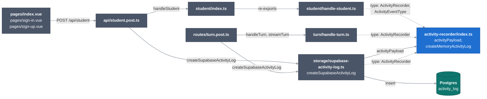

# Component: activity recorder

The one way the server appends to the activity log. The student handler and the turn handler both receive the same recorder. A payload never keeps code, a draft or keystrokes. The log is not evidence, so it never changes mastery, and only the [staff review](15-staff-review.md) page lists it, to a lecturer or an administrator. The same interface reads one student's events back, oldest first (`forStudent`), for the [learning pattern](16-learning-pattern.md) and the [study suggestion](18-study-suggestion.md); the turn handler is the only server reader. Each `ActivityRow` carries the log's own `id` (a larger id is a later row; the database's identity column, a counter in memory) and the `courseId` the event was about, so a reader can keep one course's rows and order them as the log did.

> [C4 index](../../README.md) / Level 3: Components / Turn and admin server

`web/server/activity-recorder/index.ts` holds the event types, the payload filter and the in-memory log. The Supabase adapter is `web/server/storage/supabase-activity-log.ts`. Part of [server/00-overview.md](00-overview.md).

Legend: solid = runtime import, dashed = type-only import, thick = HTTP call with no import. Blue = this component, grey = other components, teal = database.

## Events

| Type | Written by | Payload |
|---|---|---|
| `signed_in` | Student handler, reported from sign-in or sign-up when the student is sent to the workspace | `{}`, and the course is null |
| `module_opened` | Student handler, reported by the workspace after a module opens | `{ moduleId }` |
| `mode_switched` | Student handler, reported by the workspace | `{ mode }`: `learn` or `practice` |
| `layout_switched` | Student handler, reported by the workspace | `{ layout }`: `study` or `mindmap` |
| `code_run` | Student handler, reported by the workspace | `{ exerciseId }` only. A run still going when the practice panel goes away is included |
| `run_finished` | Student handler, reported by the workspace when a run ends | `{ exerciseId, outcome, errorType }`. Outcome is `completed`, `error`, `stopped` or `failed`. `errorType` is a Python error name, or null. Never the code, the output or the message |
| `pasted` | Student handler, reported by the workspace | `{ exerciseId, characters }`. The character count only, never the pasted text |
| `went_idle` | Student handler, reported by the workspace | `{ moduleId, exerciseId }` after three minutes in Practice mode without typing, pasting, clicking Run, Stop or Submit, changing exercise or module, or sending a message. The clock waits while a run or a check is in progress |
| `returned` | Student handler, reported by the workspace | `{ moduleId, exerciseId }` for the place that went quiet, when activity resumes or the student leaves Practice mode |
| `submitted` | Turn, on a submission | Module, exercise, tests passed and tests total. Never the code |
| `quiz_answered` | Turn, on the first stored answer to a question | Module, question and whether it was correct. A repeat appends nothing |
| `message_sent` | Turn, on a student message | Module, and whether the message quoted something. Never the text, the draft or a run |
| `note_created`, `note_changed`, `note_linked`, `note_unlinked`, `note_deleted` | Student handler | Ids only, never the note text |
| `mindmap_moved` | Student handler | The kind and id, `{ imported: true }` for a one-time import, or `{ reset: true }` when clearing saved positions |
| `profile_changed` | Student handler | Whether the name or the picture changed, never the picture |
| `approach_written` | Turn handler | `{ moduleId, exerciseId }`: the student's message while the agreed plan's approach step was current. Never the words |
| `plan_agreed` | Turn handler | `{ moduleId }`: the student pressed Start |
| `idle_check_in` | Turn handler | `{ moduleId, exerciseId }`: the Teacher was asked to check in after a quiet period; any later activity other than going quiet ends that period |

A turn that opens or selects a module appends nothing. The workspace reports `module_opened` once that open has succeeded. A preview request on the student handler writes nothing. A rejected report writes nothing. A client report the handler does not recognise, or whose JSON is larger than 1024 characters, is refused and writes nothing. An exercise id on a run, a paste or a quiet-period report is an id of at most 80 letters, digits, underscores or hyphens.

## The table

`activity_log` columns: student, course (optional), event type, a JSON object payload, and `created_at`. The adapter does not send `created_at`; the database stamps the server time. `activityPayload` drops the keys `code`, `draft` and `keystrokes` before the in-memory log or the insert, and a check constraint rejects a payload that still has one of those keys.

Row-level security is on with no policy. Insert and select are granted to the server role only. Update and delete are granted to nobody, including the server role. `anon` and `authenticated` cannot read, update or delete.

Home and the profile tell the student that their activity, submitted code and conversations are recorded, that their lecturers and administrators can review them, and that DeepSeek processes their conversations. No page lists the events. The student model does not import this component.

## Verified imports

- Runtime: `storage/supabase-activity-log.ts` imports `activityPayload` from `activity-recorder`. `student/index.ts` re-exports `handle-student.ts`, which is what `api/student.post.ts` imports.
- Type only: `storage/supabase-activity-log.ts` imports `ActivityRecorder`. `student/handle-student.ts` imports `ActivityRecorder` and `ActivityEventType`. `turn/handle-turn.ts` imports `ActivityRecorder` and calls `forStudent` for the learning pattern. The routes do not import this folder; they construct `createSupabaseActivityLog` and pass it in.
- Browser: `app/activity/record.ts` posts to `POST /api/student` and ignores a failure, so a missed report does not undo the action. `pages/index.vue` reports `module_opened` for the module the workspace opens onto and again when the student opens another, `mode_switched` only when the student chooses Learn or Practice, `layout_switched`, and both `code_run` and `run_finished` when a run ends (including a failure, a stop, or the practice panel going away while the run is still going). `run_finished` carries the outcome and the error name, never the code. A paste in the editor reports `pasted` with the character count. Three minutes without activity in Practice mode reports `went_idle`; the clock waits while a run or a check is in progress. The next activity, or leaving Practice, reports `returned` for the place that went quiet. `pages/sign-in.vue` and `pages/sign-up.vue` report `signed_in`. Applying a turn's own mode does not record a mode switch. The course preview does not report these events.
- Tests: `student-handler.test.ts` and `turn-endpoint.test.ts` use `createMemoryActivityLog`. `activity-log-migration.test.ts` runs the migration (and the note-with-first-link function) on PGlite. `activity-mindmap-boundary.test.ts` checks the live project.
