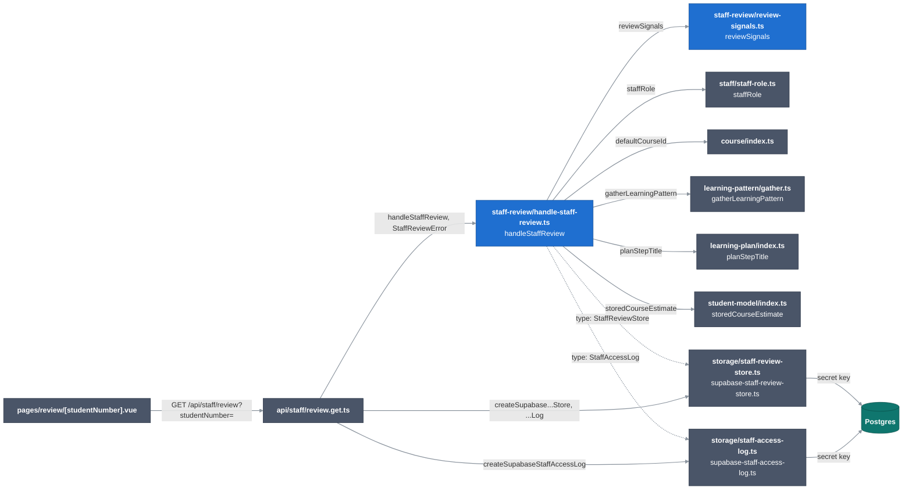

# Component: staff-review

> [C4 index](../../README.md) / Level 3: Components / Turn and admin server

`web/server/staff-review/`: `index.ts`, `handle-staff-review.ts` and `review-signals.ts`. What a lecturer or an administrator may read about one student (ADR 0009, ADR 0013). It decides who may read, writes the staff access log, reads the records through a store and works out the review signals, and adds the student's learning plans and learning pattern, and for the owning lecturer only each module's mastery. Part of [server/00-overview.md](00-overview.md).

Legend: solid = runtime import, dashed = type-only import. Blue = this component, grey = other components, teal = database.

## Behaviour (from the code)

| Step | What happens |
|---|---|
| Who may open | No email: `StaffReviewError` 401. An email that is neither an administrator's nor a lecturer's (a student): 403. An administrator may open any student (404 for a student number that does not exist) and reads the Python course. A lecturer only a student enrolled in a course they own (`ownedCourseOf`); any other student, existing or not, is 403, so a number cannot be probed. A person who is both is treated as the administrator. |
| Logging | After the role check and before any record is read, `accessLog.record` writes who (email and role), which student, the course and what was opened (`student_review`). If that write fails the request fails and nothing is handed over. A refused request writes nothing. |
| What it returns | `StaffReview` (`shared/staff-review.ts`): the student's name, number, campus and email; the latest 100 activity events newest first, plus any older event a signal links to; the submissions with code, per-test results and outcome; the conversations by module; the signals, every revision of each learning plan (oldest first, each step in words from the course content, a step the module no longer has shown by its kind and ref) and the whole learning pattern: the weak spots and also the recurring errors, attempts, hint rungs and time on materials that the student never sees. The pattern is read through `gatherLearningPattern`, the same code the turn uses, over stores scoped to the reviewed course. For a lecturer only, `mastery` lists every module of the course with its name, its stored mastery (ADR 0008, read through `masteries` from `module_masteries`; 0 with no row) and its state: `mastered` at the threshold with a passed exercise, `open` when `storedCourseEstimate` unlocks it, otherwise `closed` (ADR 0013). An administrator's review has no `mastery` field and no mastery is read for them. A student gets none of it: the role check refuses them before anything is read. |
| Review signals | `reviewSignals(events)` is a pure function of the activity events, run on every opening and never stored. For each passing `submitted` event it looks at the events on the same exercise since the previous pass: a `pasted` of 200 characters or more gives `large_paste_then_pass`, and no `code_run` or `run_finished` gives `pass_without_run`. Each signal carries the ids of the events behind it and a summary worded as "Worth a look". It writes nothing and never touches mastery. |

## Verified imports

- Runtime: `staff/staff-role` (`staffRole`), `student-model` (`storedCourseEstimate`), `course` (`defaultCourseId`), `learning-pattern/gather`, `learning-plan` (`planStepTitle`), `./review-signals`.
- Type only: `storage/staff-access-log` (`StaffAccessLog`, `StaffAccessRole`), `storage/staff-review-store` (`StaffReviewStore`, with `learningPlans` and `masteries`), `storage/course-store` (`CourseStore`), `shared/staff-review`.
- It never imports Supabase code; `api/staff/review.get.ts` passes the stores in. The administrator reads the log through [`admin`](09-admin.md).
- Tests: `review-signals.test.ts` (the two signals), `staff-review-handler.test.ts` (who may open, the mastery the owning lecturer alone sees, the log written for every opening, the log read by an administrator only) and `staff-access-log-migration.test.ts` (the table is append-only and closed to `anon` and `authenticated`, on PGlite).
