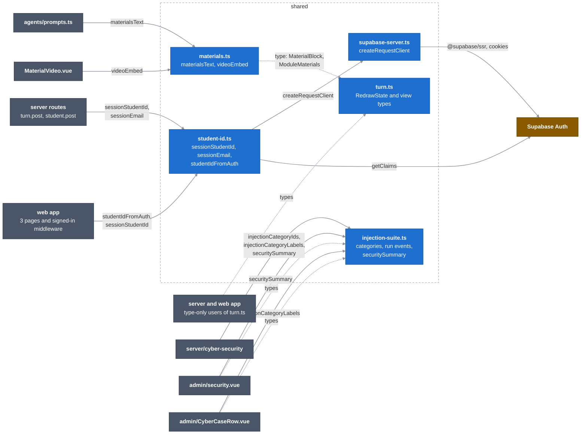

# Component: shared

> [C4 index](../README.md) / Level 3: Components / Shared by both

`web/shared/`: code and types used by both the server and the browser. Part of
[server/00-overview.md](server/00-overview.md) and [web-app/00-overview.md](web-app/00-overview.md).

Legend: solid = runtime import, dashed = type-only import. Blue = this component, grey = users of it, brown = external.

## Files

| File | Responsibility |
|---|---|
| `campus.ts` | The four campuses, the `Campus` type and `isCampus`. |
| `student-email.ts` | The student email domain, its message and `isStudentEmail`, used by the sign-up page and by the sign-in code handler. |
| `student-id.ts` | `studentIdFromAuth(client)` reads the signed-in user's id from the session claims (`getClaims`). `sessionStudentId(event)` and `sessionEmail(event)` do the same on the server from request cookies and return `null` when Supabase is not configured. Staff routes do not use `sessionEmail`; they read the confirmed email from the user record with the secret key. |
| `supabase-server.ts` | `createRequestClient(event, url, publishableKey)`: a Supabase server client that reads cookies from the request and writes refreshed ones to the response. |
| `turn.ts` | The screen state (`RedrawState`), roadmap, working area, conversation, trace and the `TurnEvent` stream; `AddressedAgent`, `RuleCheck`, and the one runtime value `agentNames` (Teacher, Mai), the single agent-to-display-name map. `MaterialBlock` is one materials block: text, code, diagram, image or video. |
| `course-progress.ts` | `courseProgress(modules)` derives **Course progress** (mastered, total, percent rounded down) from module states, counting every module the course lists, with or without content. Imports only the `ModuleState` type from `turn.ts`. Used by `CourseRoadmap.vue`, `server/lecturer/handle-lecturer.ts` and `server/staff-review/handle-staff-review.ts`. |
| `materials.ts` | `materialsText` flattens a module's blocks for the Teacher prompt. `videoEmbed` returns a YouTube or Vimeo player address, or null so any other address stays a link. |
| `injection-suite.ts` | The injection suite as both sides see it: the eight category ids and their labels, the case and listing types, the run event types, and `securitySummary`, which tallies a run's finished cases into a score. Forbidden fragments stay on the server. |

## Verified imports

- `student-id.ts` imports `supabase-server.ts` at runtime and, as types, `@supabase/supabase-js` and `h3`. It also uses `useRuntimeConfig`, which is auto-imported.
- `supabase-server.ts` imports `@supabase/ssr` and `h3`.
- Runtime importers of `student-id.ts`: `routes/turn.post.ts`, `api/admin.post.ts`, `app/middleware/signed-in.ts`, `app/pages/index.vue`, `home.vue`, `sign-in.vue`.
- `agentNames` is imported at runtime by `app/workspace/addressed-agent` and `app/admin/decisions`; `AddressedAgent`/`RuleCheck` by `verify-shield/decide`, `storage/decision-log`, `storage/conversation-store`, `storage/supabase-decision-log`.
- Type-only importers of `turn.ts`: `course/course`, `course/course-spec`, `course/materials`, `agents/contexts`, `turn/handle-turn`, `app/pages/index.vue`, seven workspace components (`ConversationPanel`, `CourseRoadmap`, `MaterialBlocks`, `PracticePanel`, `QuizPanel`, `MindmapCanvas`, `WorkingArea`), `app/python/protocol`, `app/mindmap/arrangement`. The browser files reach it through the Nuxt alias `#shared/turn`, `app/python/protocol` by relative path.
- Runtime importers of `materials.ts`: `agents/prompts.ts` (`materialsText`) and `MaterialVideo.vue` (`videoEmbed`). `materials.test.ts` tests `videoEmbed` and `diagramTheme`.
- Runtime importers of `injection-suite.ts`: `server/cyber-security/injection-suite.ts` (`injectionCategoryIds`, `injectionCategoryLabels`), `server/cyber-security/handle-records.ts` (`securitySummary`), `app/pages/admin/security.vue` (`securitySummary`, through `#shared/injection-suite`), `app/components/admin/CyberCaseRow.vue` (`injectionCategoryLabels`), and both cyber-security tests (`injectionCategoryIds`, and `securitySummary` in `cyber-security-run.test.ts`). Type-only importers: `server/cyber-security/handle-suite.ts`, `handle-run.ts`, `handle-records.ts` and `run-suite.ts`, `server/storage/cyber-test-record-store.ts`, `supabase-cyber-test-record-store.ts`, `api/admin/security-run.post.ts`, the three `api/admin/security-records*` routes (through the component), `cyber-security-records.test.ts`, `security.vue` (the view, run event and record types), and `CyberCaseRow.vue` (`InjectionAgent`, `InjectionCaseEvent`). `index.ts` re-exports from `injection-suite.ts` and does not import `shared`; `fixture.ts` uses no shared type.
- No test imports `student-id.ts` or `supabase-server.ts`. `mindmap-arrangement.test.ts` imports `turn.ts`.

## Notes

- `student-id.ts` is imported from browser code and server code alike. The `event`-based functions are called only on the server (`import.meta.server` branches in the pages), the `studentIdFromAuth` one in both.
