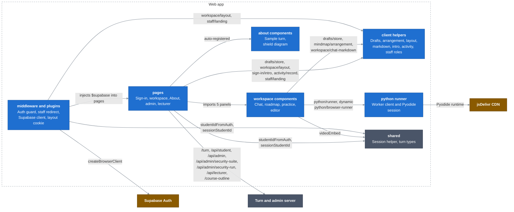

# C4 Level 3: Components of the Web app

> [C4 index](../../README.md) / Level 3: Components / Web app

Component-level view of `web/app/` (plus `web/shared/`). Every arrow was checked against a real `import`
statement or, where there is none, against the file that creates the link (marked as thick arrows).

Legend: solid arrow = runtime import (including dynamic `import()`). Thick arrow = runtime link with no import
(Nuxt auto-registration, Nuxt plugin, middleware by name, HTTP call). Blue = component in this app, grey = other
container or component, brown = external.
Type-only imports are listed in the table below instead of drawn.

Note: `python/highlight.ts` lives in `app/python/` but is used only by the two CodeMirror components. It is
counted with the python runner component in [web-app/05-python-runner.md](05-python-runner.md), and shown there as a separate file.

## Components

| Component | Path | Detail |
|---|---|---|
| pages | `web/app/pages/`, `app.vue`, `app.config.ts` | [web-app/01-pages.md](01-pages.md) |
| workspace components | `web/app/components/workspace/` | [web-app/02-workspace-components.md](02-workspace-components.md) |
| about components | `web/app/components/home/` | [web-app/03-about-components.md](03-about-components.md) |
| client helpers | `web/app/drafts/`, `mindmap/`, `workspace/`, `sign-in/`, `activity/`, `staff/` | [web-app/04-client-helpers.md](04-client-helpers.md) |
| python runner | `web/app/python/` | [web-app/05-python-runner.md](05-python-runner.md) |
| middleware and plugins | `web/app/middleware/`, `web/app/plugins/` | [web-app/06-middleware-and-plugins.md](06-middleware-and-plugins.md) |
| shared | `web/shared/` | [shared.md](../shared.md) |

## Type-only imports (not drawn)

| From | To | What |
|---|---|---|
| pages (`index.vue`), ws (7 files, including `MaterialBlocks`), py (`protocol.ts`), helpers (`arrangement.ts`) | shared | `shared/turn.ts` types: `RedrawState`, `RoadmapModule`, `QuizQuestionView`, `MaterialBlock`, `ExerciseCheck`, ... |
| pages (`admin/security.vue`) | shared | `shared/injection-suite.ts` types: `InjectionSuiteView`, `InjectionCaseEvent`, `InjectionRunEvent`, `InjectionAgent`, `InjectionRunProvider`, `CyberTestRecordListItem`, `CyberTestRecordDetail` |
| components (`admin/CyberCaseRow.vue`) | shared | `shared/injection-suite.ts` types: `InjectionCaseEvent`, `InjectionAgent` |
| ws (`ChatInline.vue`) | helpers | `InlineNode` from `workspace/chat-markdown.ts` |
| py (`browser-runner.ts`) | py (`protocol.ts`) | `ToWorker`, `FromWorker` |

## Files with no importer (entry points)

Nuxt loads these by convention, not by import: `app.vue`, `app.config.ts`, the pages under `app/pages/`, the
three middleware files, both plugins, and `browser-worker.mjs` (started with `new Worker(new URL(...))`).
