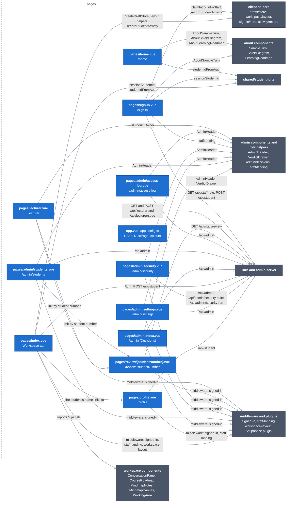

# Component: pages

> [C4 index](../../README.md) / Level 3: Components / Web app

The routes of the web app and the app shell. Part of [web-app/00-overview.md](00-overview.md).

Legend: solid = runtime import, thick = runtime link with no import (Nuxt auto-registration, HTTP call, middleware
by name). Blue = this component, grey = other components or containers.

## Files

| File | Responsibility (from the code) |
|---|---|
| `pages/index.vue` | The workspace. Opens the student's module with `{event: 'open'}` and reports that module as `module_opened`. Reads streamed turn events (NDJSON), sends messages, submissions and quiz answers (`{event: 'quiz_answer'}`, one question at a time, under the same lock as a submission), selects modules and exercises, prefetches module views on hover, and switches between the Study and Mindmap layouts (query `?layout=`, cookie). The Mindmap layout has no conversation: its side panel holds the current module's Study link and the notes editor, padded as a card. On phones it opens in a bottom sheet over the canvas behind the Notes tab. Selecting an unlocked module uses the usual turn to update the resume point. The Study link opens that module in the Study layout, and selecting a closed module shows its reason. A note has a title, text underneath, a colour and one required module, and it can link to the student's other notes. Save is what writes it; the saved note is a draggable card on the canvas with a line to that module, and two linked notes are joined by a line. Reads the deskmate switch from the turn state and sets it with `{event: 'deskmate_switch'}`; it makes no `/api/admin` request. There is no staff opt-out: the `staff-landing` middleware sends staff away on every open. The navbar shows the student's picture, or their initials when there is none; the picture URL is the Nuxt state `student-picture-url`, shared with `profile.vue` so a new picture shows at once, and cleared on sign-out. Signs out with `$supabase.auth.signOut()`. Choosing Learn or Practice, switching layout, and opening another module are each one report to `POST /api/student`. A finished run reports `code_run` (the exercise id only) and `run_finished` (the outcome and the error name, never the code), including a failure, a stop, or a run still going when the practice panel goes away. Pasting into the editor reports `pasted` with the character count, never the text. Three minutes without typing in the editor or the message box, pasting, clicking Run, Stop or Submit, changing exercise or module, or sending a message in Practice mode reports `went_idle`. The clock waits while a run or a check is in progress and starts again when it ends. The next such action, or leaving Practice, reports `returned` for the module and exercise that went quiet. A mode the turn itself applies is not a report. The page does not list the activity log. After a client activity report that does not redraw the workspace, it asks for the `open` redraw (debounced, and dropped if the student has acted since) so the [study suggestion](../server/18-study-suggestion.md) follows the log; the redraw introduces the module only while its conversation is empty. Remembered module views never keep a suggestion. |
| `components/workspace/StudySuggestionDialog.vue` | The dialog `pages/index.vue` shows over the workspace, on the Study and Mindmap layouts alike, while `RedrawState.studySuggestion` is set and the campus step is done. It shows the server's sentence and a button with the server's label, a Close button and Escape. Both Close and the button emit and the page posts `dismiss_study_suggestion` first; the button then moves the student with the controls they already have (open a module in Learn, open an exercise in Practice, or open the Study layout on an exercise) and never submits code. A failed dismissal leaves the dialog up with an error. |
| `components/workspace/CampusStep.vue` | The blocking campus step `pages/index.vue` teleports over the workspace while the student's campus is null; posts `campus_chosen` once. `lecturer.vue` filters enrolled students by campus; `admin/students.vue` changes a campus. |
| `pages/sign-in.vue` | Email and password form using `$supabase.auth.signInWithPassword`, and a student form beside it: `POST /api/sign-in-code` sends a 6-digit code, then `$supabase.auth.verifyOtp` signs the student in; a wrong or expired code, and a new code, are handled on the page. After sign-in, and on the server for a user already signed in, `staffLanding` (`staff/landing`) sends the administrator to `/admin`, a lecturer to `/lecturer`, and anyone else to `/`. A student sent to `/` reports `signed_in` to `POST /api/student`. Plays a first-visit intro (`sign-in/intro`). Both forms show `RecordingNotice`, the notice a student reads on first sign-in. |
| `components/RecordingNotice.vue` | The notice on sign-in, Home and the profile. One paragraph: activity, submitted code and conversations are recorded; lecturers and administrators can review them; DeepSeek processes conversations. |
| `pages/home.vue` | Public Home page: a small course roadmap that plays one module unlock, the shield diagram, the sample turn and the team. Shows `RecordingNotice`: activity, submitted code and conversations are recorded, lecturers and administrators can review them, and DeepSeek processes conversations. |
| `pages/profile.vue` | Profile page, reached from the student's name in the workspace: the display name and the picture, saved with `{event: 'profile_changed'}`. A new name shows as `Saved.` and a new picture as `Picture saved.` and also updates the shared `student-picture-url` state the workspace navbar reads. While a picture uploads, the picture dims under a spinner and the button reads `Uploading…`. The picture is cropped square on the device before it is sent; the page checks the type (JPEG, PNG or WebP) and size (2 MB or smaller) first so a file the server would refuse is stopped there. Email and student number are shown and cannot be changed. The picture is chosen with an English `Upload picture` button (the browser's own file button follows the browser's language, so the input is hidden behind a label). Shows `RecordingNotice`. |
| `pages/admin/index.vue` | Decisions page: the newest 100 decisions at full width with verdict and student filters, shown 10 per page. Beside the heading, the decision log's hash chain is the single word `verified` or `broken`. Each verdict (`step cap` for a Teacher that reached its tool step cap, which is not a verdict) is a button that opens `VerdictDrawer` from the decision already loaded (no extra request), showing the rule checks (or, for a step-cap outcome, that the Teacher reached its step cap and nothing was ruled on), the tool calls, the proposed and ruled moves and the addressed agent of the turn; closing returns focus to the verdict. Shows a refusal on 403. |
| `pages/admin/students.vue` | Students page: every student's name, student number and email, with a link to the staff review page and an inline form to change one student's number. The page checks `SWB` + at least four digits before sending; the server's 400 keeps the reason (wrong format, duplicate, a number used before) as an alert, and a successful change refreshes the list. Shows a refusal on 403. |
| `pages/admin/access-log.vue` | Staff access log page: who opened which student's records and when, newest 200, from `POST /api/admin` with `{event: 'staffAccessLog'}`. Shows a refusal on 403, so a lecturer sees only that. |
| `pages/review/[studentNumber].vue` | Staff review page, read only: the student, the review signals (each linking to the activity events behind it, worded as something to look at), the learning plan (every revision per module, steps in words), the whole learning pattern (weak spots plus the habits a student never sees), submissions with code and per-test results, the conversation by module and the latest activity. Reached from `lecturer.vue` and `admin/students.vue` by student number; loads `GET /api/staff/review`, which writes the staff access log. A student, or a lecturer for a student outside their courses, gets a refusal. |
| `pages/admin/settings.vue` | Settings page: the VerifyShield switch and the language model form. Shows a refusal on 403. |
| `pages/admin/security.vue` | Cyber Security page: the committed injection suite grouped by attack family, each case with its prompt, addressed agent, earlier-turn count and note, beside a Run the suite button with its case counter. Run posts `/api/admin/security-run` and reads the NDJSON stream line by line: the `start` event seeds the total, the model label, the start time and the shield state captured for that run, each `case` event is appended as it lands, and `done` records how the run stopped and its duration. Cancel aborts the stream; a run already in progress answers 409 and an invalid suite 500. The summary above the results is computed from the events on the page alone: score as the share of finished cases with no leak, passed and leaked counts, finished of total, families reached, and the run's model, shield state, start time and live duration (ticked by the browser clock), with a note that nothing is kept, so a reload starts blank. A fake provider shows a rehearsal warning. The VerifyShield switch reads the saved setting with `POST /api/admin` `{event: 'read'}` and writes `{event: 'verifyShield', enabled}`, refreshing after either outcome, showing a rose alert on failure, and staying disabled with an explanation if the read fails; a Settings link sits beside it. Shows a refusal on 403, and lists every validation problem when the suite will not load. |
| `components/admin/AdminHeader.vue` | Header shared by the administrator pages: the Decisions/Students/Access log/Cyber Security/Settings nav (`aria-current` on the current page), a Lecturer page link when `isLecturer` succeeds (the switch for someone who also lectures), and Sign out. It has no link to a student page. |
| `components/admin/VerdictDrawer.vue` | Native modal `<dialog>` drawer: the rule checks in order with ✓/✗ and plain-English reasons, the deciding check highlighted, proposed and ruled move, masteries, unlocked modules, threshold, VerifyShield state, the code version and the course history entry (each `not recorded` when the decision was stored before that was kept). Escape, the close button or a click on the backdrop close it; full screen on a phone. |
| `admin/decisions.ts`, `staff/landing.ts` | The admin payload types (decisions, model settings, the student directory), the reason-code wording and `drawerChecks` (shield off: no checks and a note; older record: the deciding rule only and a note); `isProductOwner` and `isLecturer` through the cheap role checks (`POST /api/admin` with `{event: 'role'}`, `GET /api/lecturer`), and `staffLanding`, which runs both checks and sends an administrator to `/admin`, a lecturer to `/lecturer` and a student nowhere. Agent names (`Teacher`, `Mai`) come from `agentNames` in `shared/turn.ts`, shared with the `@` menu. |
| `pages/lecturer.vue` | Shows owned courses, enrollment counts, course history and the enrolled students of each course: name, student number, email and enrollment date, searchable by name or student number and sortable by any of those columns client-side. Each student has a link to the read-only staff review page; this page itself shows no code, conversation, mastery or activity. Lecturers can set the mastery threshold. The Editor pane (`components/lecturer/CourseEditor.vue`) edits the course draft: add, reorder and remove parts and modules, move a module to a part, edit materials blocks with a live Mermaid preview, the quiz (choices, correct choice, explanation), exercises (statement, starter code, reference solution), the hint ladder and misconception responses. It saves the draft, discards it, imports a course spec JSON into it, exports the draft and the published spec, and Publish saves what is on screen and then publishes it. Validation errors from the server name the module and field. The Preview pane (`components/lecturer/CoursePreviewPanel.vue`) shows the draft as a student would see it: one module at a time, its materials blocks, its quiz with the correct choice named, the hint ladder and the misconception responses, each teacher-only part marked, beside a practice panel that runs the module's exercises and Submits against the draft's own tests in the browser. It loads `GET /api/lecturer/spec?preview=1`, so it never calls the turn endpoint, asks an agent or records anything, and reference solutions never reach it. Both are imported explicitly, since Nuxt's auto-import would name them `Lecturer…`. An administrator who also lectures gets the Administrator page switch; staff sign out from this header. Sign-in routes authorized lecturers here, and a student row links to `review/[studentNumber].vue`. |
| `app.vue`, `app.config.ts` | `UApp` with `NuxtPage` and the light colour mode; colours come from the tokens in `docs/agents/palette.md`. |

## Verified imports

- `index.vue`: `StudySuggestionDialog`, `ConversationPanel`, `CourseRoadmap`, `MindmapNotes`, `MindmapCanvas`, `WorkingArea`, `shared/turn` (type), `shared/student-id`, `drafts/store`, `workspace/layout`, `activity/record`.
- `sign-in.vue`: `shared/student-id`, `shared/student-email`, `sign-in/intro`, `activity/record`.
- `home.vue`: `shared/student-id`.
- `profile.vue`: `StudentResponse` (type) from `server/student`.
- `admin/index.vue`: `AdminHeader`, `VerdictDrawer`, `admin/decisions` (types). `admin/settings.vue` and `admin/students.vue`: `AdminHeader`, `admin/decisions` (type), `admin/message`. `admin/students.vue` also imports `shared/student-number`. `admin/security.vue`: `AdminHeader`, `BusySpinner`, `admin/message`, `admin/decisions` (type) and `#shared/injection-suite` (`securitySummary` and the view and event types). `sign-in.vue`, `lecturer.vue` and `AdminHeader.vue` also import `staff/landing`. `lecturer.vue` imports `CourseEditor` and `CoursePreviewPanel`; `CourseEditor` imports `MermaidDiagram`.
- `AboutSampleTurn`, `AboutShieldDiagram` and `AboutLearningRoadmap` are used in templates without an import (Nuxt component auto-registration from `components/about/`). `RecordingNotice` is the same, from `components/`, on `sign-in.vue`, `home.vue` and `profile.vue`.
- Middleware is attached by name in `definePageMeta`: `index.vue` uses `['signed-in', 'staff-landing', 'workspace-layout']`; `profile.vue` uses `['signed-in', 'staff-landing']`; the five admin pages and `lecturer.vue` use `'signed-in'`. `home.vue` and `sign-in.vue` set none.
- Nothing imports the pages; Nuxt routes them from the file names. No test imports them; the Playwright specs in `web/e2e/` drive them in a browser.
