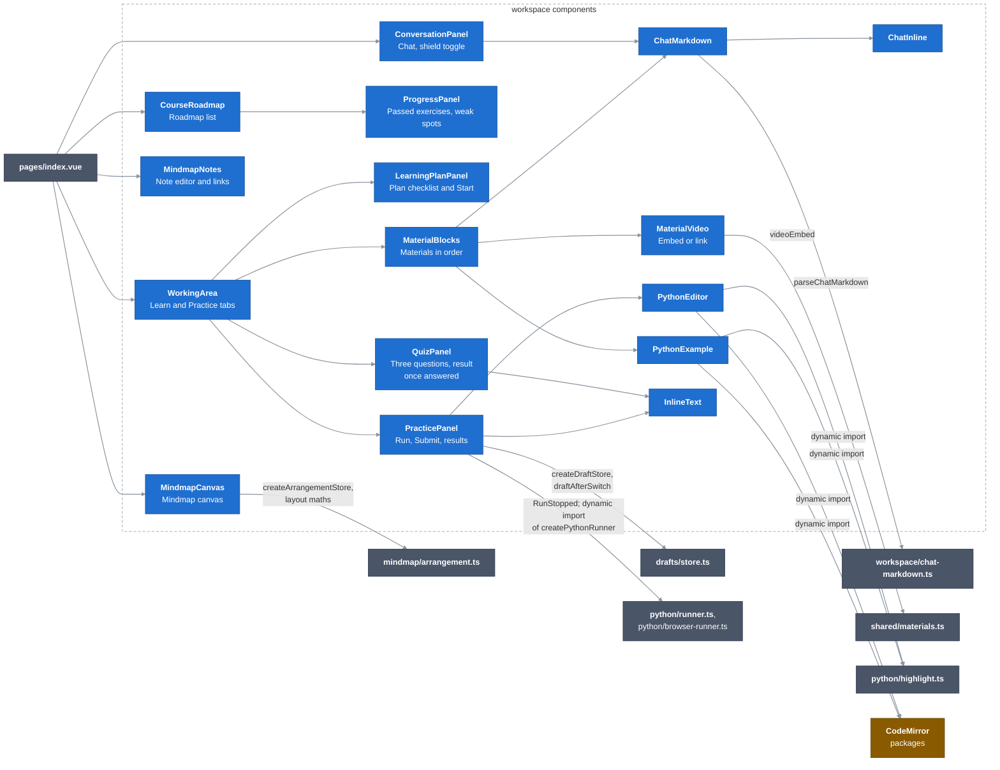

# Component: workspace components

> [C4 index](../../README.md) / Level 3: Components / Web app

The panels of the workspace: conversation, course roadmap list, mindmap canvas, materials, the module quiz, practice and editor.
`web/app/components/workspace/`. Part of [web-app/00-overview.md](00-overview.md).

Legend: solid = runtime import (dashed lines are not used here because every `shared/turn` import is a type and
is listed below). Blue = this component, grey = other components, brown = external.

## Files

| File | Responsibility |
|---|---|
| `ConversationPanel.vue` | Bubbles for student, Teacher and Deskmate with portraits, typing rows, event rows (exercise and test summaries), the message box with the `@` menu (an `@` at the start offers Teacher and Mai, Mai only while the deskmate switch is on; the choice becomes a removable chip, Backspace on an empty box removes it; the sent bubble shows the tag), the deskmate switch with a busy spinner, and the turn's notice. Menu logic is in `workspace/addressed-agent.ts`. Emits `send(text, addressedAgent)`, `openLearn`, `toggleDeskmate`, and `active` when the message box changes. `active` carries no text. |
| `ChatMarkdown.vue`, `ChatInline.vue` | Render the small Markdown subset of a reply from the tree that `chat-markdown.ts` produces (never raw HTML). A reply keeps a heading line as bold text. Materials pass `headings`, so a lesson title is a heading (`h2` to `h6`; the module name stays the page's only `h1`). |
| `CourseRoadmap.vue` | Roadmap as a list grouped by part, with mastery bars, the threshold mark and the reason a module is closed, then the `ProgressPanel`. Its header shows Course progress (count, bar, %) from `courseProgress` in `shared/course-progress`. Takes `progress` and `weakSpots` from the turn state and passes them on. Emits `selectModule` and `prefetchModule`. |
| `ProgressPanel.vue` | The student's progress under the roadmap: the exercises passed, each with its module and its attempt count, and the weak spots in plain words, each with a plain empty line when there are none. Mastery per module is the roadmap's bar above it. Shows only `progress` and `weakSpots` from the turn state, so no review signal and no activity event can reach it. Emits nothing. |
| `MindmapCanvas.vue` | Mindmap canvas with draggable module cards, connectors, and a view that pans and zooms, including pinch zoom on phones. A saved note is a smaller card with a line to its module, and a line also joins two notes the student linked. Its controls (`Reset arrangement`, zoom out, fit, zoom in) sit at the bottom centre in a labelled toolbar with 44 px hit areas. The canvas emits position changes to the workspace page, which saves them with the student account. |
| `MindmapNotes.vue` | The notes panel, built with Nuxt UI: the student's notes as a list, and one slot that shows either the read view or the editor. Choosing a note opens it read-only (title, image, body rendered as Markdown, an `Edit` button); `New note` and `Edit` open the editor in the same place and size. The editor's title, text and link pickers are Nuxt UI `UFormField`, `UInput`, `UTextarea` and `USelect`. It holds the title and text, one optional image (`Add image`, `Replace image`, `Remove image`), a colour from the palette tokens in `shared/mindmap.ts`, the module the note hangs on, and the links to the student's other notes with their `Remove link`. A finished save (the `saved` prop) returns to the read view. Emits `select`, `save(draft)` (the draft carries a picked image file, `null` to remove it, or nothing), `remove`, `link(noteId, targetNoteId)` and `unlink(linkId)`. The page shrinks a picked image with `utils/shrink-image.ts`; a new note sends it with `note_created`, so the save is one request, and a saved note sends `note_image_changed`; and its X button folds the whole mindmap panel to an `Open the mindmap panel` button. |
| `WorkingArea.vue` | Learn mode (the module's plan, then its materials, then the quiz) and Practice mode (the practice panel). Materials are an ordered list of blocks. In the floating canvas layout it shows Learn only. The learn column cannot scroll sideways. Passes the quiz's `answer` event up as `quizAnswer`, which the page binds as `@quiz-answer`, the plan panel's `start` as `startPlan`, and the practice panel's `active` and `running` up unchanged. |
| `LearningPlanPanel.vue` | The module's plan above the materials: the Teacher's 1–5 steps in order with titles the server computed, the current one marked, steps the server marks `done` ticked, a heading and a Start button while the plan is unagreed, and an "In progress" badge once it is. Emits `start`; a Start in progress shows a spinner (`starting` prop) and disables the button. Renders no Markdown itself: step titles arrive as text. |
| `StudySuggestionDialog.vue` | The dialog that covers the workspace with the one study suggestion: the server's sentence, a button with the server's label, Close and Escape. Props `suggestion`, `busy`, `error`; emits `close` and `follow`, and `pages/index.vue` dismisses first and then moves the student. Renders no Markdown. |
| `QuizPanel.vue` | The module's three questions under the materials, four choices each, collapsed behind a "Show quiz" button until the student opens it (the open state is not remembered). A choice on an unanswered question emits `answer`, which the page sends as a `quiz_answer` turn; the server marks it. Once a question is answered, its result (right or wrong, the correct choice, the explanation) comes back in the working area, and the student can click other choices to explore without another turn, because only the first answer counts. |
| `PracticePanel.vue` | Exercise chips, editor, Run and Submit. Runs code and tests in the Pyodide worker, keeps the draft in `localStorage` per student and exercise, emits `draft`, `run`, `runFinished`, `pasted`, `active`, `running` and `submit`. `runFinished` is the exercise id, the outcome (`completed`, `error`, `stopped` or `failed`) and the error name when a run ends, including a failure, a stop, or the panel going away mid-run, and never the code. `pasted` is the character count of a paste, never the text. `active` is a Run, Stop or Submit click. `running` is true while a run or a check is in progress. |
| `PythonEditor.vue` | CodeMirror 6 editor bound with `v-model`. Tab accepts the highlighted autocomplete suggestion; with none open Tab moves focus on, so keyboard users are not trapped. A paste emits the character count only. |
| `PythonExample.vue` | Read-only, highlighted code example. A long line scrolls inside the example, not the page. |
| `MaterialBlocks.vue` | Renders one module's materials in order: text (Markdown), a Python example, an image (URL and alt text, on a white card in both colour modes so a diagram drawn for paper stays readable on ink), or a video. |
| `MaterialVideo.vue` | A YouTube or Vimeo address is an embedded player. Any other address is a link with the video's title. |
| `InlineText.vue` | Shows backtick spans as inline code. It has its own small parser; it does not use `chat-markdown.ts`. |

## Verified imports

- As drawn. `MindmapNotes.vue` imports only the `NoteColour` type from `shared/mindmap`. `CourseRoadmap.vue` and `ConversationPanel.vue` import only types from `shared/turn` (and `ChatMarkdown`); `CourseRoadmap.vue` also imports `ProgressPanel.vue`, which imports only the `ProgressView` type from `shared/turn`.
- Type-only imports of `shared/turn` (through the `#shared/turn` alias): `ConversationPanel`, `CourseRoadmap`, `MaterialBlocks` (`MaterialBlock`), `PracticePanel`, `QuizPanel` (`QuizQuestionView`), `MindmapCanvas`, `WorkingArea`. `ChatInline` has a type-only import of `workspace/chat-markdown`.
- `MaterialVideo` imports `videoEmbed` from `shared/materials` at runtime.
- `PracticePanel` also has a runtime import of `python/runner` (`RunStopped`) and a dynamic import of `python/browser-runner`.
- `PythonEditor` and `PythonExample` load `codemirror`, `@codemirror/lang-python`, `@codemirror/state` and `python/highlight` with dynamic `import()` inside `onMounted`.
- Imported by: `pages/index.vue` (the workspace panels). `CoursePreviewPanel.vue` imports `MaterialBlocks` and `PracticePanel`. `CourseEditor.vue` imports `app/utils/shrink-image.ts` (`shrinkImage`: long side cut to 1024 px, re-encoded as WebP in the browser) and uploads an image block's file to `POST /api/lecturer/image`. The other files are imported by siblings only.
- `LearningPlanPanel` imports `BusySpinner` and `InlineText` and, type only, `LearningPlanView` from `shared/turn`.
- `shared/materials.ts` is tested by `materials.test.ts` and `shrink-image.ts` by `diagram-alt-text.test.ts`. No test imports the Vue files.
