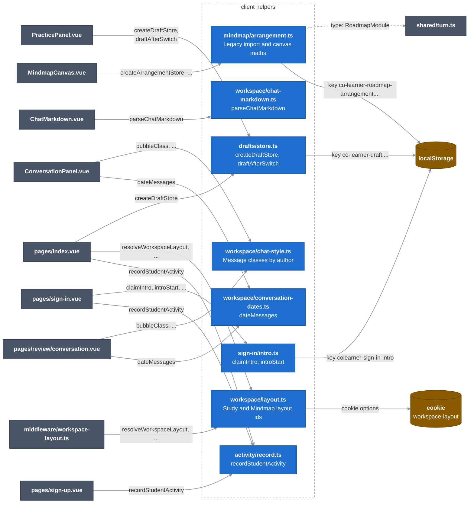

# Component: client helpers

> [C4 index](../../README.md) / Level 3: Components / Web app

Small files in `web/app/` that hold logic and per-device state. Most are framework-free. `activity/record.ts` posts with Nuxt's `$fetch` and imports nothing else. Part of
[web-app/00-overview.md](00-overview.md).

Legend: solid = runtime import, dashed = type-only import. Blue = this component, grey = users of it, brown = browser storage.

## Files

| File | Responsibility | Where state lives |
|---|---|---|
| `drafts/store.ts` | Per-student, per-exercise draft code; `draftAfterSwitch` saves the draft being left and returns the one entered (or the starter code). | The storage object passed in; `PracticePanel` passes `localStorage`. |
| `mindmap/arrangement.ts` | Where each module card sits on the canvas, zoom and pan maths, connectors, collision avoidance, and `readLegacyArrangement`. | Reads the legacy keys by student and size class from `localStorage` for one-time import. The account arrangement lives on the server. |
| `workspace/layout.ts` | The two layouts (`study`, `mindmap`), the cookie name and options, and `resolveWorkspaceLayout` (query first, then cookie, then `study`). Old values `map` and `roadmap` open Mindmap. `ide` opens Study. | Cookie `workspace-layout`, set by `pages/index.vue`. |
| `workspace/chat-markdown.ts` | Parses the Markdown subset into a node tree (paragraphs, inline code, bold, italic, lists, fenced code); never produces HTML; tolerant of half-streamed text. A heading in a reply stays bold text. Materials pass `{ headings: true }`, and that tree has a heading node. | None. |
| `workspace/chat-style.ts` | The classes and portraits of a chat message by author, shared by `ConversationPanel` and the staff conversation page. | None. |
| `workspace/conversation-dates.ts` | The day separator and time of each message, in a given time zone (the browser's by default). | None. |
| `sign-in/intro.ts` | Decides whether the sign-in intro plays (once per device, never with reduced motion) and computes the starting transform; exports an inline head script. | `localStorage` key `colearner-sign-in-intro`. |
| `activity/record.ts` | Posts one client report to `POST /api/student`: `signed_in`, `module_opened`, `mode_switched`, `layout_switched`, `code_run`, `run_finished`, `pasted`, `went_idle`, or `returned`. A failure does not undo the action. A finished run reports the exercise id, and separately its outcome and error name. A paste reports the character count. The workspace reports going quiet and coming back. | None. The server keeps the activity log, and no page lists it. |

## Verified imports

- Imports from this repo: only `mindmap/arrangement.ts` (type `RoadmapModule` from `shared/turn`). The other files import nothing from this repo. `activity/record.ts` calls `$fetch`, which Nuxt provides.
- Importers: `drafts/store` by `pages/index.vue`, `PracticePanel.vue`, `draft-store.test.ts`; `mindmap/arrangement` by `MindmapCanvas.vue`, `mindmap-arrangement.test.ts`; `workspace/layout` by `pages/index.vue`, `middleware/workspace-layout.ts`; `workspace/chat-style` and `workspace/conversation-dates` by `ConversationPanel.vue` and `pages/review/conversation.vue`; `workspace/chat-markdown` by `ChatMarkdown.vue` and `ChatInline.vue` (type), `chat-markdown.test.ts`; `sign-in/intro` by `pages/sign-in.vue`, `sign-in-intro.test.ts`; `activity/record` by `pages/index.vue`, `pages/sign-in.vue` and `pages/sign-up.vue`.
- Each file here has a unit test under `web/tests/` except `workspace/layout.ts` and `activity/record.ts`. What the server stores for a report is covered by `student-handler.test.ts`.

## Notes

- The draft stays on the student's device. The mindmap arrangement is saved per student and course. The layout is a per-device cookie.
