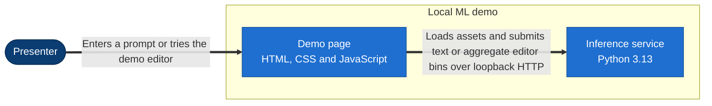
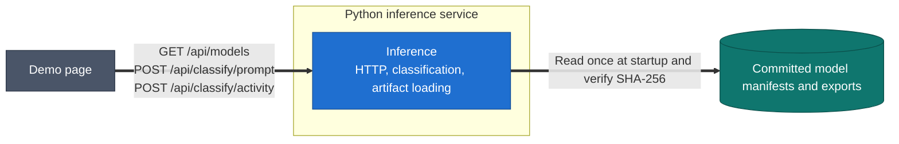

# C4 views for the local ML demo

> [C4 index](README.md) / Local ML demo

## Containers

One Python process serves the page and API on `127.0.0.1`. A browser loads the page from that origin and submits a prompt or a window of editor counts when the presenter classifies it. The editor's contents stay in the page. The deployment is the presenter's machine. The process loads the two numeric model exports at startup and keeps the parameters in memory.

## Components of the inference service

The Inference component lives in `AI/inference/`. Its files divide the work as follows.

| File | Responsibility |
|---|---|
| `server.py` | Binds to loopback, serves named assets and limits incoming JSON bodies. Returns structured errors. The demo stylesheet gets its color tokens from the repository's shared web palette. |
| `service.py` | Checks prompt input or activity window eligibility. Applies the task's threshold and reports the model version. |
| `artifacts.py` | Uses each task's manifest to select and verify its archive. Reports the task unavailable if the artifact check fails. |
| `windows.py` | Validates aggregate bins and applies the research feature extraction to complete windows. |

Inference reuses the prompt research scorer and the activity model's numeric window scorer. In the browser, `collector.js` keeps the latest editor counts in a bounded ring. It splits them into five-second bins using the observation clock. The activity form sends a snapshot of the latest 24 complete bins or a labelled synthetic sample.

The API tests run the server over loopback with the committed models or a temporary artifact directory. The browser tests drive both forms and inspect the activity requests to verify the observation timing and counts. [Start and test the demo](../../AI/README.md).
